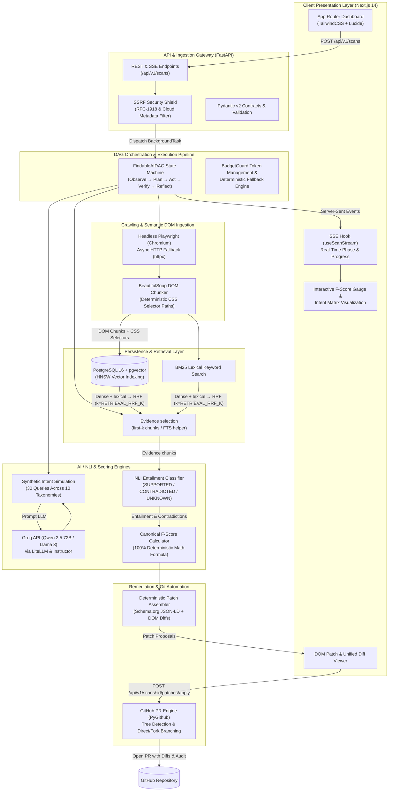
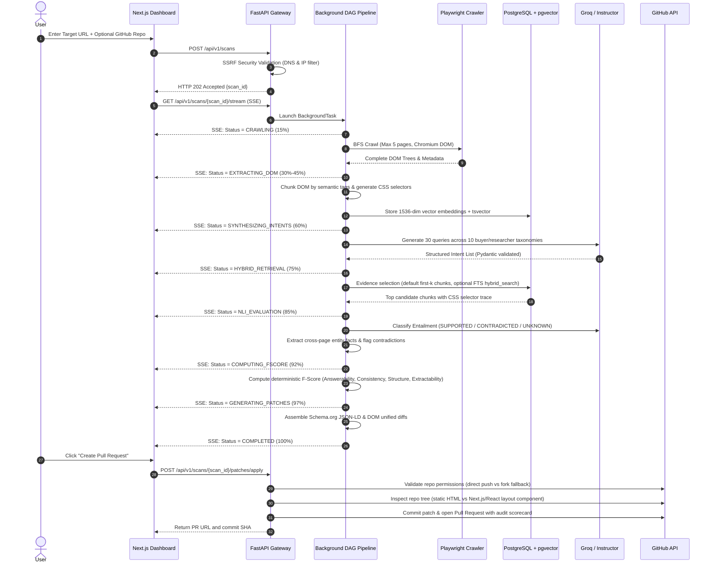

<div align="center">


# FindableAI

### Evidence-Grounded Autonomous Machine-Discoverability Optimization (MDO) Platform

[](LICENSE)
[](https://python.org)
[](https://fastapi.tiangolo.com)
[](https://nextjs.org)
[](https://github.com/pgvector/pgvector)
[](#-automated-testing-suite-614-tests)
[](https://github.com/Chirag1724/FindableAI/actions/workflows/backend-ci.yml)
[](https://github.com/Chirag1724/FindableAI/actions/workflows/frontend-ci.yml)

<p align="center">
  <b>Bridging the gap between the modern web and AI search engines.</b><br/>
  FindableAI audits public websites for machine discoverability: crawl → DOM chunks → intent/NLI (when LLM configured) → deterministic F-Score → optional remediation patches / GitHub PRs.
  It does <b>not</b> guarantee AI-search rankings, citations, or fully verified remediations.
</p>

[Architecture Deep Dive](docs/01_ARCHITECTURE_AND_SYSTEM_DESIGN.md) •
[Known Limitations & Readiness](docs/engineering/LIMITATIONS_AND_READINESS.md) •
[System Flow](docs/engineering/SYSTEM_FLOW.md) •
[AI Website Health Brief](docs/engineering/AI_WEBSITE_HEALTH_BRIEF.md) •
[Environment Reference](docs/engineering/ENVIRONMENT.md) •
[Team Task Allocation](docs/04_TEAM_TASK_ALLOCATION.md) •
[Engineering Docs](docs/engineering/README.md) •
[Security Policy](SECURITY.md)

</div>

## Project Links

| Resource                  | Link                                                                     |
| :------------------------ | :----------------------------------------------------------------------- |
| **Live Demo**             | [findableai.vercel.app](https://findableai.vercel.app/)                  |
| **Demo Video**            | *Walkthrough recording in repository artifacts*                              |                           |
| **Figma Design**          | [Figma UI/UX Prototype](https://www.figma.com/design/WH3T793esaoyj8FNY265xJ/FindableAI?m=auto&t=VhmLDDUFEAgXNS6M-1) |
| **Architecture Overview** | [System Flow & End-to-End Architecture](docs/engineering/SYSTEM_FLOW.md) |

---
## The Problem: SEO is Dying. GEO & MDO is Born.

Search is fundamentally mutating. Millions of users no longer click ten blue links - they prompt **AI Answer Engines** like Perplexity, ChatGPT Search, Gemini, and Claude.

| Traditional SEO                                          | Machine Discoverability (GEO / MDO)                                                    |
| :------------------------------------------------------- | :------------------------------------------------------------------------------------- |
| Focuses on keywords, backlinks, and meta tags            | Focuses on factual clarity, semantic density, and authoritative entity graph grounding |
| Optimized for Web Crawlers (Googlebot)                   | Optimized for LLM RAG Retrieval (Vector embeddings + BM25 hybrid search)               |
| Success metric: Search Engine Result Page (SERP) ranking | Success metric: Inclusion, Citation & Entailment in LLM-synthesized answers            |
| Manual keyword stuffing & link-building                  | Grounded Natural Language Inference (NLI) & Citation-rate optimization                 |

---
<br/>

**If an AI engine cannot reliably extract, verify, and cite your product facts, your business is effectively invisible to modern searchers.**

FindableAI is the first autonomous engine designed to diagnose, score, and remediate machine invisibility.

## Key Innovations & Core Features

```
┌────────────────────────────────────────────────────────────────────────────────────────┐
│                                 FINDABLE.AI PIPELINE                                   │
└────────────────────────────────────────────────────────────────────────────────────────┘
 [ URL / Repo ] ──► [ Playwright Crawler ] ──► [ DOM-Aware Chunker (CSS Paths) ]
                            │
                            ▼
              [ Synthetic Intent Engine ] (Persona & Query Generation)
                            │
                            ▼
           [ Evidence selection ] (hybrid dense+lexical + RRF when index hits; else first-k)
                            │
                            ▼
         [ NLI Entailment & Contradiction Engine ] (LLM-based Entailment Classification)
                            │
                            ▼
    ┌───────────────────────┴───────────────────────┐
    ▼                                               ▼
[ F-Score Engine (0-100) ]              [ Autonomous Patch Generator ]
  • Query Coverage Score (40%)            • DOM-anchored diffs
  • Consistency Score (30%)               • Schema.org JSON-LD microdata
  • Structural Clarity (20%)              • Evidence-grounded entailment checks
  • Machine Extractability (10%)                    │
                                                    ▼
                                      [ GitHub PR Automated Engine ]
```

1. **DOM-Aware Structural Chunking with CSS Path Traceability**
   - Traditional RAG chunks blindly by character count. FindableAI parses semantic DOM elements (`h1-h6`, `article`, `table`, `code`, `meta`), preserving strict CSS selectors (`div.pricing > table > tbody > tr:nth-child(2)`) so every detected gap maps directly to an exact line in code.

2. **Synthetic Intent Simulation**
   - Simulates diverse buyer personas (skeptical CTO, procurement officer, developer evaluator) generating realistic high-intent queries that AI search users ask.

3. **Evidence selection for NLI (hybrid + RRF when available)**
   - **Live path:** ACT prefers `build_act_retriever` → `hybrid_search` (dense ANN + lexical) fused by Reciprocal Rank Fusion: `score(d)=Σ 1/(k+rank)` with **1-based** ranks, `k=RETRIEVAL_RRF_K` (default 60), equal list weights, UUID-string tie-break, top-N=`RETRIEVAL_TOP_K`. Falls back to first-*k* OBSERVE chunks only when retrieval returns empty. Details: [LIMITATIONS_AND_READINESS.md](docs/engineering/LIMITATIONS_AND_READINESS.md).

4. **Natural Language Inference (NLI) & Contradiction Detection**
   - Assesses retrieved page context against target queries using NLI:
     - **Entailment:** Page provides clear, verifiable answers.
     - **Neutral:** Information is missing or ambiguous.
     - **Contradiction:** Page contains conflicting claims (e.g. outdated pricing vs FAQ).

5. **Findability F-Score (0-100 Mathematical Metric)**
   - Transparent, deterministic formula balancing query coverage, consistency penalties, structural clarity, and extractability.

6. **Remediation proposals & optional GitHub PRs**
   - Generates unified diffs / Schema.org patches and can open a GitHub PR when credentials allow. **Opening a PR does not verify that the original defect is fixed.**

7. **On-demand AI Website Health Brief (AI Summary)**
   - After a completed scan, generates a grounded plain-English brief via Gemini (`GET`/`POST /api/v1/scans/{id}/summary`), cached in `scan_summaries` with a precomputed `summary_input` snapshot. Outside the per-scan LLM call budget. Details: [AI_WEBSITE_HEALTH_BRIEF.md](docs/engineering/AI_WEBSITE_HEALTH_BRIEF.md).

## Findability F-Score Breakdown

FindableAI evaluates content across four mathematically rigorous sub-scores:

$$\text{F-Score} = 0.40 \cdot S_{\text{ans}} + 0.30 \cdot S_{\text{con}} + 0.20 \cdot S_{\text{str}} + 0.10 \cdot S_{\text{acc}}$$

Each component \(S_*\) is already on a **0–100** scale; the result is **0–100**. Do **not** apply an additional outer multiplication by 100. Canonical reference: [ADR-001](docs/engineering/ARCHITECTURE_DECISIONS.md#adr-001-canonical-f-score-weight-formulation).

1. **Answerability ($S_{\text{ans}}$, 40%)**: Mean entailment contribution across intent evaluations.
2. **Consistency ($S_{\text{con}}$, 30%)**: Absence / penalty of factual conflicts across pages.
3. **Structure ($S_{\text{str}}$, 20%)**: Coverage and validity of Schema.org JSON-LD for required types.
4. **Extractability ($S_{\text{acc}}$, 10%)**: Machine readability and DOM extractability heuristics.

## Project Architecture

FindableAI is an asynchronous multi-tier system: Next.js UI, FastAPI gateway, crawl/chunk pipeline, LLM-backed intelligence DAG (with synthetic fallback), deterministic scoring, and optional GitHub remediation. See [SYSTEM_FLOW.md](docs/engineering/SYSTEM_FLOW.md) for the verified stage list and [LIMITATIONS_AND_READINESS.md](docs/engineering/LIMITATIONS_AND_READINESS.md) for incomplete stages.

### High-Level Architectural Topology



### End-to-End Scan Data Flow



### Architectural Subsystems

| Subsystem | Responsibilities | Core Technologies | Key Modules |
| :--- | :--- | :--- | :--- |
| **Presentation Layer** | Real-time audit dashboard, reactive F-Score gauge, intent breakdown grid, interactive DOM patch diff viewer, and 1-click PR trigger. | Next.js 14 App Router, TypeScript, TailwindCSS, Lucide Icons | [`frontend/src/app/page.tsx`](frontend/src/app/page.tsx)<br/>[`frontend/src/hooks/useScanStream.ts`](frontend/src/hooks/useScanStream.ts)<br/>[`frontend/src/components/ScoreGauge.tsx`](frontend/src/components/ScoreGauge.tsx) |
| **Gateway & Security** | Ingestion endpoints, Server-Sent Events broker, Pydantic v2 validation contracts, and SSRF prevention blocking internal IP ranges and cloud metadata endpoints. | FastAPI, Uvicorn, Pydantic v2, `socket` DNS resolution | [`backend/app/main.py`](backend/app/main.py)<br/>[`backend/app/api/v1/scans.py`](backend/app/api/v1/scans.py)<br/>[`backend/app/core/security.py`](backend/app/core/security.py) |
| **DAG Orchestration** | Asynchronous execution pipeline implementing an Observe-Plan-Act-Verify-Reflect state machine with budget guarding and graceful fallbacks. | Python `asyncio`, FastAPI `BackgroundTasks`, LiteLLM | [`backend/app/orchestration/dag.py`](backend/app/orchestration/dag.py)<br/>[`backend/app/core/budget.py`](backend/app/core/budget.py) |
| **Crawling & Chunking** | Headless JavaScript rendering, domain-bounded BFS crawling, semantic DOM decomposition, and deterministic CSS selector path calculation. | Playwright (Chromium), BeautifulSoup4, `httpx` | [`backend/app/crawler/crawler.py`](backend/app/crawler/crawler.py)<br/>[`backend/app/crawler/dom_chunker.py`](backend/app/crawler/dom_chunker.py) |
| **Search & Storage** | Postgres + pgvector; embeddings written on chunk insert; `hybrid_search` = dense + lexical fused by RRF (`reciprocal_rank_fusion`, 1-based ranks, `k=RETRIEVAL_RRF_K`). Redis composed but unused by app code. | PostgreSQL 16 + pgvector, SQLAlchemy 2.0, Alembic | [`backend/app/crawler/search.py`](backend/app/crawler/search.py)<br/>[`backend/app/core/embeddings.py`](backend/app/core/embeddings.py)<br/>[`backend/app/models/`](backend/app/models/) |
| **AI / NLI & Scoring** | High-speed synthetic intent generation (30 queries, 10 taxonomies), NLI entailment classification, contradiction detection, and 100% deterministic F-Score calculation. | Groq (Qwen 2.5 72B / Llama 3), Instructor, NumPy | [`backend/app/engines/intent_generator.py`](backend/app/engines/intent_generator.py)<br/>[`backend/app/engines/entailment_engine.py`](backend/app/engines/entailment_engine.py)<br/>[`backend/app/engines/scorer.py`](backend/app/engines/scorer.py) |
| **Remediation & Git Engine** | Deterministic Schema.org JSON-LD microdata synthesis, unified diff generation, automated repository tree inspection, and 1-click GitHub Pull Request creation. | PyGithub, GitHub REST API, Schema.org specifications | [`backend/app/engines/patch_assembler.py`](backend/app/engines/patch_assembler.py)<br/>[`backend/app/github/pr_engine.py`](backend/app/github/pr_engine.py)<br/>[`backend/app/github/client.py`](backend/app/github/client.py) |

### Scan Pipeline State Machine

Each audit execution progresses through strict pipeline phases streamed directly to the frontend via SSE:

| Phase Enum | Progress | Description & Action | Resilience & Fallback Strategy |
| :--- | :--- | :--- | :--- |
| `PENDING` | 0% | Scan registered and validated; scheduled in background worker queue. | Input validation & SSRF check fail-fast. |
| `CRAWLING` | 15% | Headless Playwright Chromium BFS crawl fetching DOM snapshots. | Falls back to async `httpx` if headless browser times out. |
| `EXTRACTING_DOM` | 30%–45% | Semantic element parsing, CSS selector derivation, and vector embedding. | In-memory pseudo-embeddings if external embedding API unreachable. |
| `SYNTHESIZING_INTENTS` | 60% | Simulating 30 user/evaluator queries across 10 discovery taxonomies. | Rule-based canonical query generation if LLM budget exceeded. |
| `HYBRID_RETRIEVAL` | 75% | SSE milestone; ACT prefers `hybrid_search` + RRF when index hits. | Fallback to first-*k* OBSERVE when retrieval empty; check `RetrievalMeta.mode`. |
| `NLI_EVALUATION` | 85% | NLI classification (`SUPPORTED`, `CONTRADICTED`, `UNKNOWN`) and fact checking. | Deterministic substring/lexical entailment heuristics if rate-limited. |
| `COMPUTING_FSCORE` | 92% | Deterministic calculation of Answerability, Consistency, Structure, Extractability. | Zero LLM calls; guaranteed mathematical determinism. |
| `GENERATING_PATCHES` | 97% | Schema.org JSON-LD generation, DOM-anchored unified diffs, and score deltas. | High-priority microdata templates (Organization, LocalBusiness, FAQPage). |
| `COMPLETED` | 100% | Audit finalized in-process; best-effort DB writes. | Summary/`execution_mode` are memory-primary; cold hydrate is lossy. Synthetic/mock paths may still complete. |

## Tech Stack Summary

| Layer                       | Primary Technology                                             | Purpose                                                                                                             |
| :-------------------------- | :------------------------------------------------------------- | :------------------------------------------------------------------------------------------------------------------ |
| **Frontend**                | Next.js 14 (App Router), TypeScript, TailwindCSS, Lucide Icons | High-performance dashboard, interactive F-Score visualizer, unified diff viewer                                     |
| **Realtime Stream**         | Server-Sent Events (SSE) via `EventSource`                     | Realtime progress updates during 10-second audits                                                                   |
| **Backend API**             | FastAPI (Python 3.11), Pydantic v2, Instructor                 | Async API, schema enforcement, structured LLM outputs                                                               |
| **Crawler & Extraction**    | Playwright (Python async), BeautifulSoup4                      | JavaScript-rendered DOM harvesting with CSS path derivation                                                         |
| **Database & Vector Store** | PostgreSQL 16 + pgvector, SQLAlchemy 2.0 (async), Alembic      | Relational storage; embeddings + FTS; query-time dense + lexical RRF via `hybrid_search`                            |
| **Job Queue & Cache**       | Redis 7 in `docker-compose` (optional local service)           | Reserved for cache/rate-limit; **scans currently use FastAPI `BackgroundTasks`** (no Celery/ARQ worker in-repo yet) |
| **AI / LLM Orchestration**  | Groq (Qwen 2.5 72B) via LiteLLM & Instructor                   | Ultra-fast (~500 tps) synthetic intent generation, NLI classification, patch creation                               |
| **VCS Automation**          | PyGithub / GitHub REST API                                     | Automated branch creation, patch application, and Pull Request opening                                              |

## Repository Structure & Engineering Documentation

The project includes an engineering specification suite and active operational documentation:

```
FindableAI/
├── .github/workflows/                         # Continuous Integration (CI) workflows
│   ├── backend-ci.yml                         # Python linting, typing & pytest suite
│   └── frontend-ci.yml                        # Node linting, Vitest & Next.js build
├── assets/                                    # Official branding & vector assets
│   ├── logo.png                               # Transparent RGBA high-res logo
│   └── logo.svg                               # Scalable vector logo mark
├── backend/                                   # FastAPI asynchronous core API
│   ├── alembic/                               # Database migration scripts (PostgreSQL + pgvector)
│   ├── app/
│   │   ├── api/v1/                            # Route controllers (health, scans, SSE stream, patches)
│   │   ├── core/                              # Config, auth, rate limiting, LLM & budget management
│   │   ├── crawler/                           # Headless Playwright crawler & DOM chunker
│   │   ├── engines/                           # Intent generation, NLI entailment, scorer & patch assembler
│   │   ├── github/                            # Autonomous PR engine & markdown report generator
│   │   ├── models/                            # SQLAlchemy ORM models (Scan, Intent, Contradiction, Patch)
│   │   ├── orchestration/                     # Directed Acyclic Graph (FindableAIDAG) state machine
│   │   ├── schemas/                           # Pydantic data contracts (scan, fscore, scoring, patching)
│   │   ├── db.py                              # Database engine & async sessionmaker
│   │   └── main.py                            # Application entrypoint with security middleware
│   ├── tests/                                 # Unit & integration test suite (pytest + pytest-asyncio)
│   ├── Dockerfile                             # Multi-stage production container image
│   ├── pyproject.toml                         # Ruff linter, formatter & Mypy type-checking config
│   └── requirements.txt                       # Python dependencies (FastAPI, Playwright, pgvector, LiteLLM)
├── demo-site/                                 # Intentionally flawed test target (missing schema, contradictory info)
│   ├── index.html                             # Flawed landing page for demonstration audits
│   ├── about.html                             # Conflicting operational hours page
│   ├── menu.html                              # Unlabelled photo menu testing visual extraction gaps
│   └── style.css                              # Demo site stylesheet
├── docs/                                      # System design playbooks & engineering guides
│   ├── engineering/                           # Complete operational engineering documentation
│   │   ├── README.md                          # Engineering documentation index
│   │   ├── SYSTEM_FLOW.md                     # End-to-end execution flow & pipeline lifecycle
│   │   ├── API_REFERENCE.md                   # Full REST & SSE endpoint specification
│   │   ├── DEPLOYMENT.md                      # Production deployment & environment variable matrix
│   │   ├── LOCAL_DEVELOPMENT.md               # Clean-clone developer onboarding runbook
│   │   ├── ARCHITECTURE_DECISIONS.md          # Architecture Decision Records (ADRs)
│   │   ├── TESTING.md                         # Test strategy, coverage metrics & execution commands
│   │   ├── TROUBLESHOOTING.md                 # Problem -> Cause -> Solution operational runbook
│   │   └── ROADMAP.md                         # Delivery status & forward-looking initiatives
│   ├── 01_ARCHITECTURE_AND_SYSTEM_DESIGN.md   # Complete system blueprints & component math
│   ├── 02_TECH_STACK_AND_IMPLEMENTATION.md    # Tech choices, trade-offs & library configs
│   ├── 03_EXECUTION_PLAYBOOK.md               # 7-phase step-by-step engineering roadmap
│   └── 04_TEAM_TASK_ALLOCATION.md             # Role breakdown, ownership map & contracts
├── frontend/                                  # Next.js 14 App Router real-time dashboard
│   ├── public/                                # Web assets (favicons, SVGs)
│   ├── src/
│   │   ├── app/                               # Pages (page.tsx, audit/page.tsx, scans/[id]/page.tsx)
│   │   ├── components/                        # UI widgets (ScoreGauge, IntentMatrix, PatchModal)
│   │   ├── hooks/                             # Custom hooks (useScanStream, useScanData, useCountUp)
│   │   ├── lib/                               # API client, diff parsers, phase transitions
│   │   ├── test/                              # Vitest test setup and test utilities
│   │   └── types/                             # TypeScript interface contracts mirroring backend
│   ├── Dockerfile                             # Multi-stage Next.js standalone container
│   ├── package.json                           # Frontend scripts and dependencies
│   ├── tailwind.config.ts                     # Cybernetic design tokens & glassmorphism utilities
│   └── vitest.config.ts                       # Vitest configuration for frontend tests
├── .env.example                               # Unified environment configuration template
├── docker-compose.yml                         # Local PostgreSQL 16 (pgvector) + Redis 7 services
├── LICENSE                                    # Open source MIT license (Findable AI)
├── SECURITY.md                                # Security policy & SSRF defense guidelines
└── README.md                                  # Repository overview and onboarding
```

### Detailed Documentation Guide

| Document                                                                          | Focus & Highlights                                                                                                                                                                                                                         |
| :-------------------------------------------------------------------------------- | :----------------------------------------------------------------------------------------------------------------------------------------------------------------------------------------------------------------------------------------- |
| **[Engineering Documentation](docs/engineering/README.md)**                       | • Index for API reference, deployment, testing, ADRs, troubleshooting, and roadmap                                                                                                                                                         |
| **[System Flow & Lifecycle](docs/engineering/SYSTEM_FLOW.md)**                     | • Step-by-step audit lifecycle from URL input to GitHub PR<br/>• Full mermaid sequence flowcharts & state machine progress mapping                                                                                                        |
| **[01. Architecture & System Design](docs/01_ARCHITECTURE_AND_SYSTEM_DESIGN.md)** | • End-to-end dataflow pipeline<br/>• 9 component deep-dives (Crawler, DOM chunker, NLI engine, PR engine)<br/>• F-Score formal mathematical formulation<br/>• Cost & latency model (<$0.01 per scan, ~10s runtime)                         |
| **[02. Tech Stack & Implementation](docs/02_TECH_STACK_AND_IMPLEMENTATION.md)**   | • Python 3.11 + FastAPI async core<br/>• Next.js 14 App Router + TailwindCSS dashboard<br/>• PostgreSQL 16 + pgvector with HNSW indexing<br/>• Instructor + Pydantic validation<br/>• Server-Sent Events (SSE) realtime streaming protocol |
| **[03. Execution Playbook](docs/03_EXECUTION_PLAYBOOK.md)**                       | • Phases from foundation through production release gates<br/>• Concrete code snippets and database migrations<br/>• Quality gates and unit/integration test specifications                                                                |
| **[04. Team Task Allocation](docs/04_TEAM_TASK_ALLOCATION.md)**                   | • 3-person ownership map and historical milestone allocation                                                                                                                                                                               |

## Quickstart & Local Setup

### Prerequisites

- **Python:** 3.11+
- **Node.js:** 20+ & `npm` / `pnpm`
- **Docker & Docker Compose** (for PostgreSQL + pgvector + Redis)
- **API Keys:** Groq API Key (`GROQ_API_KEY`) (optional fallbacks: OpenAI / Gemini / Anthropic)

### 1. Clone & Environment Configuration

```bash
git clone https://github.com/Chirag1724/FindableAI.git

# Copy environment template
cp .env.example .env
```

### 2. Start Infrastructure Services

```bash
docker compose up -d postgres redis
```

### 3. Run locally (Docker → migrations → API + worker → frontend)

Scans are executed by a **separate worker process** (`python -m app.worker`), not by the
API. With the defaults `DURABLE_SCAN_JOBS=true` / `SCAN_JOB_INLINE_FALLBACK=false`, the API
only enqueues a durable `scan_jobs` row; if no worker is running the scan stays `queued`
forever (the API logs a startup warning and `GET /api/v1/ready` reports
`worker: stale_or_absent`).

```bash
# 3a. Infrastructure (PostgreSQL + pgvector). Port comes from POSTGRES_PORT in .env
#     (default 5432; this repo's local .env uses 55432 to avoid clashes).
docker compose up -d postgres
docker compose ps                      # expect findable-postgres ... (healthy)

# 3b. Backend env + deps
cd backend
python -m venv venv
.\venv\Scripts\activate                # Windows
source venv/bin/activate               # Linux/macOS
pip install -r requirements.txt
playwright install chromium

# 3c. Migrations (never drop/recreate the volume; always upgrade on top of current head)
alembic current                        # expect 0012_indexes_and_token_ledger (head) or older
alembic upgrade head

# 3d. Verify provider credentials (one minimal request per configured provider; no keys printed)
python scripts/check_providers.py

# 3e. Start API + worker together (single command; Ctrl-C stops both)
python scripts/run_local.py
#   equivalent to running these in two terminals:
#   uvicorn app.main:app --host 127.0.0.1 --port 8000
#   python -m app.worker

# 3f. Readiness: database, queue and worker liveness
curl -s http://127.0.0.1:8000/api/v1/ready
```

### 4. Frontend Setup

```bash
cd frontend
npm install
npm run dev
```

Visit `http://localhost:3000` to access the FindableAI Scan Console.

### 4b. One real read-only scan (smoke)

```bash
cd backend
python scripts/local_smoke_scan.py --url https://example.com
```

Expected normal-path provider usage for one scan: 3 intent-generation requests
(one per persona) + 3 evaluation requests (3 batches × 10 intents, one persona per batch)
+ 0–6 contradiction-judgment requests = **6–12 provider requests**. `MAX_LLM_CALLS_PER_SCAN`
(default 35 in `.env`) therefore leaves room for bounded retries/splits without
hiding amplification. Every outbound request — including retries, splits and failovers —
counts exactly once against that budget.

### 5. Automated Testing Suite (653 Tests)

FindableAI maintains a production-grade test suite covering API contracts, DOM parsing, DAG orchestration, NLI entailment, AI Lighthouse scoring, and UI interactions:

```bash
# Backend (from repo root)
cd backend
# use project venv if present
pytest -v

# Frontend
cd frontend
npm run test
```

Test suite sizes and “passed” badges in marketing copy can drift. Re-run the commands above for current counts. Unit/integration tests with fakes do **not** prove live Groq, GitHub, or production deploy success. See [docs/engineering/TESTING.md](docs/engineering/TESTING.md).

### 6. Production Cloud Deployment (Vercel + Render)

FindableAI is configured for streamlined cloud deployment with a split architecture:

- **End-to-End Walkthrough:** [docs/engineering/DEPLOYMENT.md](docs/engineering/DEPLOYMENT.md)
- **Render Blueprint (Backend API, Worker, Redis):** [`render.yaml`](render.yaml)
- **Vercel Manifest (Next.js 14 Frontend):** [`frontend/vercel.json`](frontend/vercel.json)
- **Operational Architecture & Env Reference:** [docs/engineering/DEPLOYMENT.md](docs/engineering/DEPLOYMENT.md) & [docs/engineering/ENVIRONMENT.md](docs/engineering/ENVIRONMENT.md)

## Team Roles & Ownership

This project is architected for seamless execution across three dedicated roles:

```
┌─────────────────────────────────────────────────────────────────────────────────┐
│                               TEAM RESPONSIBILITIES                             │
├──────────────────────┬───────────────────────────────┬──────────────────────────┤
│ Himanshu Raj         │ Shiv Raj Singh                │ Chirag Dwivedi           │
│ Full-Stack & Systems │ Backend & AI Engine Lead      │ UI Stubs & Release Coord │
├──────────────────────┼───────────────────────────────┼──────────────────────────┤
│ • FastAPI Backend    │ • Synthetic Query Generator   │ • UI Components & Shells │
│ • Web Crawl & Chunker│ • NLI Entailment & Contradict │ • Client API & Normalizer│
│ • AI Lighthouse & TXT│ • Findability F-Score Engine  │ • Vitest UI Test Suite   │
│ • Patch Assembler    │ • Durable Jobs & Queue Leases │ • Assets, SEO & Manifest │
│ • Landing & Patch UI │ • LLM Budget & Observability  │ • Deployment & PR Config │
└──────────────────────┴───────────────────────────────┴──────────────────────────┘
```
*For complete task matrices, contract definitions, and milestone checklists, see [docs/04_TEAM_TASK_ALLOCATION.md](docs/04_TEAM_TASK_ALLOCATION.md).*

## Contributing

We welcome contributions from the community. Please review our [Execution Playbook](docs/03_EXECUTION_PLAYBOOK.md) and [Architecture Specifications](docs/01_ARCHITECTURE_AND_SYSTEM_DESIGN.md) before submitting pull requests.

1. Fork the Project
2. Create your Feature Branch (`git checkout -b feature/InnovativeFeature`)
3. Commit your Changes (`git commit -m 'Add some InnovativeFeature'`)
4. Push to the Branch (`git push origin feature/InnovativeFeature`)
5. Open a Pull Request

---

<div align="center">

<p>MIT Licensed</p>
<p>Designed &amp; Maintained with 💖 by <a href="https://github.com/ErebAsh">Himanshu</a>, <a href="https://github.com/imuniqueshiv">Shiv</a> and <a href="https://github.com/Chirag1724">Chirag</a></p>

</div>

