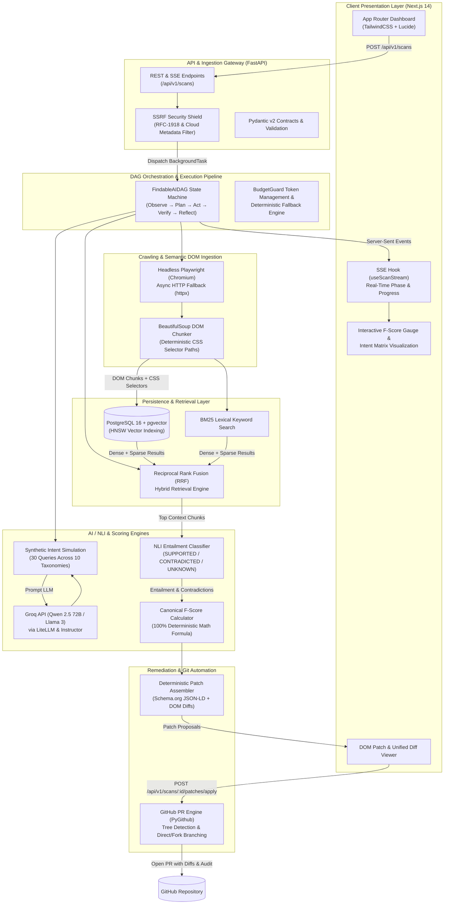
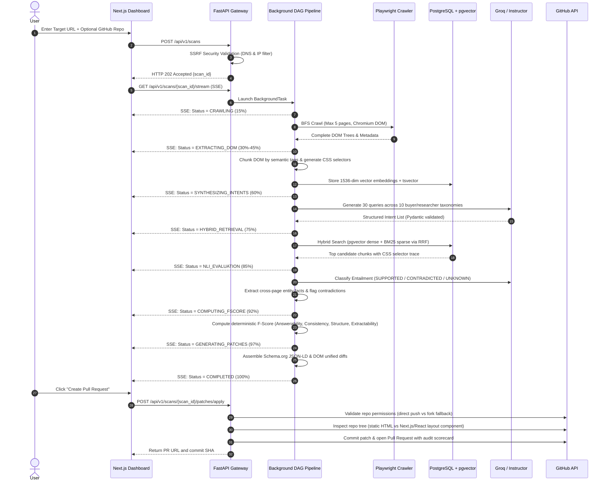

<div align="center">


# FindableAI

### Evidence-Grounded Autonomous Machine-Discoverability Optimization (MDO) Platform

[](LICENSE)
[](https://python.org)
[](https://fastapi.tiangolo.com)
[](https://nextjs.org)
[](https://github.com/pgvector/pgvector)
[](docs/)
[](https://github.com/Chirag1724/FindableAI/actions/workflows/backend-ci.yml)
[](https://github.com/Chirag1724/FindableAI/actions/workflows/frontend-ci.yml)

<p align="center">
  <b>Bridging the gap between the modern web and AI search engines.</b><br/>
  FindableAI autonomously audits web content against AI answer engines (Perplexity, SearchGPT, Gemini, ChatGPT Search), computes an evidence-grounded Findability F-Score, and generates precise, zero-hallucination GitHub pull requests with DOM-anchored patches.
</p>

[Architecture Deep Dive](docs/01_ARCHITECTURE_AND_SYSTEM_DESIGN.md) •
[Tech Stack & Implementation](docs/02_TECH_STACK_AND_IMPLEMENTATION.md) •
[Execution Playbook](docs/03_EXECUTION_PLAYBOOK.md) •
[Team Task Allocation](docs/04_TEAM_TASK_ALLOCATION.md) •
[Engineering Documentation](docs/engineering/README.md) •
[Security Policy](SECURITY.md)

</div>

## Project Links

| Resource                  | Link                                                                     |
| :------------------------ | :----------------------------------------------------------------------- |
| **Live Demo**             | [findableai.vercel.app](https://findableai.vercel.app/)                  |
| **Demo Video**            | [Demo Video (add link here)](add link here)                              |
| **Pitch Deck**            | [Pitch Deck (add link here)](add link here)                              |
| **Figma Design**          | [Figma Design (optional - add link here)](add link here)                 |
| **Architecture Overview** | [System Flow & End-to-End Architecture](docs/engineering/SYSTEM_FLOW.md) |

---

## The Problem: SEO is Dying. GEO & MDO is Born.

Search is fundamentally mutating. Millions of users no longer click ten blue links - they prompt **AI Answer Engines** like Perplexity, ChatGPT Search, Gemini, and Claude.

| Traditional SEO                                          | Machine Discoverability (GEO / MDO)                                                    |
| :------------------------------------------------------- | :------------------------------------------------------------------------------------- |
| Focuses on keywords, backlinks, and meta tags            | Focuses on factual clarity, semantic density, and authoritative entity graph grounding |
| Optimized for Web Crawlers (Googlebot)                   | Optimized for LLM RAG Retrieval (Vector embeddings + BM25 hybrid search)               |
| Success metric: Search Engine Result Page (SERP) ranking | Success metric: Inclusion, Citation & Entailment in LLM-synthesized answers            |
| Manual keyword stuffing & link-building                  | Grounded Natural Language Inference (NLI) & Citation-rate optimization                 |

---
<br/>

**If an AI engine cannot reliably extract, verify, and cite your product facts, your business is effectively invisible to modern searchers.**

FindableAI is the first autonomous engine designed to diagnose, score, and remediate machine invisibility.

## Key Innovations & Core Features

```
┌────────────────────────────────────────────────────────────────────────────────────────┐
│                                 FINDABLE.AI PIPELINE                                   │
└────────────────────────────────────────────────────────────────────────────────────────┘
 [ URL / Repo ] ──► [ Playwright Crawler ] ──► [ DOM-Aware Chunker (CSS Paths) ]
                            │
                            ▼
              [ Synthetic Intent Engine ] (Persona & Query Generation)
                            │
                            ▼
           [ Hybrid Retrieval ] (pgvector dense + BM25 sparse + RRF)
                            │
                            ▼
         [ NLI Entailment & Contradiction Engine ] (LLM-based Entailment Classification)
                            │
                            ▼
    ┌───────────────────────┴───────────────────────┐
    ▼                                               ▼
[ F-Score Engine (0-100) ]              [ Autonomous Patch Generator ]
  • Query Coverage Score (40%)            • DOM-anchored diffs
  • Consistency Score (30%)               • Schema.org JSON-LD microdata
  • Structural Clarity (20%)              • Evidence-grounded entailment checks
  • Machine Extractability (10%)                    │
                                                    ▼
                                      [ GitHub PR Automated Engine ]
```

1. **DOM-Aware Structural Chunking with CSS Path Traceability**
   - Traditional RAG chunks blindly by character count. FindableAI parses semantic DOM elements (`h1-h6`, `article`, `table`, `code`, `meta`), preserving strict CSS selectors (`div.pricing > table > tbody > tr:nth-child(2)`) so every detected gap maps directly to an exact line in code.

2. **Synthetic Intent Simulation**
   - Simulates diverse buyer personas (skeptical CTO, procurement officer, developer evaluator) generating realistic high-intent queries that AI search users ask.

3. **Hybrid Retrieval with Reciprocal Rank Fusion (RRF)**
   - Combines dense vector similarity (`text-embedding-3-small` / pgvector) with lexical BM25 retrieval to mirror how state-of-the-art AI answer engines assemble context windows.

4. **Natural Language Inference (NLI) & Contradiction Detection**
   - Assesses retrieved page context against target queries using NLI:
     - **Entailment:** Page provides clear, verifiable answers.
     - **Neutral:** Information is missing or ambiguous.
     - **Contradiction:** Page contains conflicting claims (e.g. outdated pricing vs FAQ).

5. **Findability F-Score (0-100 Mathematical Metric)**
   - Transparent, deterministic formula balancing query coverage, consistency penalties, structural clarity, and extractability.

6. **Autonomous Code Remediations (Direct GitHub PRs)**
   - Instead of generic marketing advice, FindableAI generates actionable unified diffs (DOM additions, content clarifications, Schema.org JSON-LD) and opens ready-to-merge GitHub Pull Requests.

## Findability F-Score Breakdown

FindableAI evaluates content across four mathematically rigorous sub-scores:

$$\text{F-Score} = 100 \times \left( 0.40 \cdot S_{\text{ans}} + 0.30 \cdot S_{\text{con}} + 0.20 \cdot S_{\text{str}} + 0.10 \cdot S_{\text{acc}} \right)$$

1. **Answerability ($S_{\text{ans}}$, 40%)**: Ratio and depth of critical synthetic buyer and researcher queries answered by crawled content.
2. **Consistency ($S_{\text{con}}$, 30%)**: Absence of factual conflicts across pages (operating hours, pricing, policies, contact details).
3. **Structure ($S_{\text{str}}$, 20%)**: Coverage and syntactic validity of Schema.org JSON-LD microdata across core entity types.
4. **Extractability & Accessibility ($S_{\text{acc}}$, 10%)**: Clean machine readability and DOM structural clarity of key entity metadata.

## Project Architecture

FindableAI is built as an asynchronous, event-driven, multi-tier system that bridges client-side dynamic rendering, vector-based RAG retrieval, structured LLM inference, and automated version control operations.

### High-Level Architectural Topology



### End-to-End Scan Data Flow



### Architectural Subsystems

| Subsystem | Responsibilities | Core Technologies | Key Modules |
| :--- | :--- | :--- | :--- |
| **Presentation Layer** | Real-time audit dashboard, reactive F-Score gauge, intent breakdown grid, interactive DOM patch diff viewer, and 1-click PR trigger. | Next.js 14 App Router, TypeScript, TailwindCSS, Lucide Icons | [`frontend/src/app/page.tsx`](frontend/src/app/page.tsx)<br/>[`frontend/src/hooks/useScanStream.ts`](frontend/src/hooks/useScanStream.ts)<br/>[`frontend/src/components/ScoreGauge.tsx`](frontend/src/components/ScoreGauge.tsx) |
| **Gateway & Security** | Ingestion endpoints, Server-Sent Events broker, Pydantic v2 validation contracts, and SSRF prevention blocking internal IP ranges and cloud metadata endpoints. | FastAPI, Uvicorn, Pydantic v2, `socket` DNS resolution | [`backend/app/main.py`](backend/app/main.py)<br/>[`backend/app/api/v1/scans.py`](backend/app/api/v1/scans.py)<br/>[`backend/app/core/security.py`](backend/app/core/security.py) |
| **DAG Orchestration** | Asynchronous execution pipeline implementing an Observe-Plan-Act-Verify-Reflect state machine with budget guarding and graceful fallbacks. | Python `asyncio`, FastAPI `BackgroundTasks`, LiteLLM | [`backend/app/orchestration/dag.py`](backend/app/orchestration/dag.py)<br/>[`backend/app/core/budget_guard.py`](backend/app/core/budget_guard.py) |
| **Crawling & Chunking** | Headless JavaScript rendering, domain-bounded BFS crawling, semantic DOM decomposition, and deterministic CSS selector path calculation. | Playwright (Chromium), BeautifulSoup4, `httpx` | [`backend/app/crawler/crawler.py`](backend/app/crawler/crawler.py)<br/>[`backend/app/crawler/dom_chunker.py`](backend/app/crawler/dom_chunker.py) |
| **Hybrid Search & Storage** | Dense vector similarity search combined with sparse BM25 keyword matching using Reciprocal Rank Fusion (RRF). | PostgreSQL 16 + pgvector, SQLAlchemy 2.0, Alembic, Redis | [`backend/app/crawler/search.py`](backend/app/crawler/search.py)<br/>[`backend/app/core/embeddings.py`](backend/app/core/embeddings.py)<br/>[`backend/app/models/`](backend/app/models/) |
| **AI / NLI & Scoring** | High-speed synthetic intent generation (30 queries, 10 taxonomies), NLI entailment classification, contradiction detection, and 100% deterministic F-Score calculation. | Groq (Qwen 2.5 72B / Llama 3), Instructor, NumPy | [`backend/app/engines/intent_generator.py`](backend/app/engines/intent_generator.py)<br/>[`backend/app/engines/entailment_engine.py`](backend/app/engines/entailment_engine.py)<br/>[`backend/app/engines/scorer.py`](backend/app/engines/scorer.py) |
| **Remediation & Git Engine** | Deterministic Schema.org JSON-LD microdata synthesis, unified diff generation, automated repository tree inspection, and 1-click GitHub Pull Request creation. | PyGithub, GitHub REST API, Schema.org specifications | [`backend/app/engines/patch_assembler.py`](backend/app/engines/patch_assembler.py)<br/>[`backend/app/github/pr_engine.py`](backend/app/github/pr_engine.py)<br/>[`backend/app/github/client.py`](backend/app/github/client.py) |

### Scan Pipeline State Machine

Each audit execution progresses through strict pipeline phases streamed directly to the frontend via SSE:

| Phase Enum | Progress | Description & Action | Resilience & Fallback Strategy |
| :--- | :--- | :--- | :--- |
| `PENDING` | 0% | Scan registered and validated; scheduled in background worker queue. | Input validation & SSRF check fail-fast. |
| `CRAWLING` | 15% | Headless Playwright Chromium BFS crawl fetching DOM snapshots. | Falls back to async `httpx` if headless browser times out. |
| `EXTRACTING_DOM` | 30%–45% | Semantic element parsing, CSS selector derivation, and vector embedding. | In-memory pseudo-embeddings if external embedding API unreachable. |
| `SYNTHESIZING_INTENTS` | 60% | Simulating 30 user/evaluator queries across 10 discovery taxonomies. | Rule-based canonical query generation if LLM budget exceeded. |
| `HYBRID_RETRIEVAL` | 75% | Reciprocal Rank Fusion (RRF) blending dense pgvector and sparse BM25. | In-memory cosine similarity ranking if database vector extension unavailable. |
| `NLI_EVALUATION` | 85% | NLI classification (`SUPPORTED`, `CONTRADICTED`, `UNKNOWN`) and fact checking. | Deterministic substring/lexical entailment heuristics if rate-limited. |
| `COMPUTING_FSCORE` | 92% | Deterministic calculation of Answerability, Consistency, Structure, Extractability. | Zero LLM calls; guaranteed mathematical determinism. |
| `GENERATING_PATCHES` | 97% | Schema.org JSON-LD generation, DOM-anchored unified diffs, and score deltas. | High-priority microdata templates (Organization, LocalBusiness, FAQPage). |
| `COMPLETED` | 100% | Audit finalized; complete metrics, contradictions, and patches saved. | Results persisted in database and cached for fast recall. |

## Tech Stack Summary

| Layer                       | Primary Technology                                             | Purpose                                                                                                             |
| :-------------------------- | :------------------------------------------------------------- | :------------------------------------------------------------------------------------------------------------------ |
| **Frontend**                | Next.js 14 (App Router), TypeScript, TailwindCSS, Lucide Icons | High-performance dashboard, interactive F-Score visualizer, unified diff viewer                                     |
| **Realtime Stream**         | Server-Sent Events (SSE) via `EventSource`                     | Realtime progress updates during 10-second audits                                                                   |
| **Backend API**             | FastAPI (Python 3.11), Pydantic v2, Instructor                 | Async API, schema enforcement, structured LLM outputs                                                               |
| **Crawler & Extraction**    | Playwright (Python async), BeautifulSoup4                      | JavaScript-rendered DOM harvesting with CSS path derivation                                                         |
| **Database & Vector Store** | PostgreSQL 16 + pgvector, SQLAlchemy 2.0 (async), Alembic      | Relational audit storage + hybrid BM25 / vector embeddings                                                          |
| **Job Queue & Cache**       | Redis 7 in `docker-compose` (optional local service)           | Reserved for cache/rate-limit; **scans currently use FastAPI `BackgroundTasks`** (no Celery/ARQ worker in-repo yet) |
| **AI / LLM Orchestration**  | Groq (Qwen 2.5 72B) via LiteLLM & Instructor                   | Ultra-fast (~500 tps) synthetic intent generation, NLI classification, patch creation                               |
| **VCS Automation**          | PyGithub / GitHub REST API                                     | Automated branch creation, patch application, and Pull Request opening                                              |

## Repository Structure & Engineering Documentation

The project includes an engineering specification suite and active operational documentation:

```
FindableAI/
├── .github/workflows/                         # Continuous Integration (CI) workflows
│   ├── backend-ci.yml                         # Python linting, typing & pytest suite
│   └── frontend-ci.yml                        # Node linting, Vitest & Next.js build
├── assets/                                    # Official branding & vector assets
│   ├── logo.png                               # Transparent RGBA high-res logo
│   └── logo.svg                               # Scalable vector logo mark
├── backend/                                   # FastAPI asynchronous core API
│   ├── alembic/                               # Database migration scripts (PostgreSQL + pgvector)
│   ├── app/
│   │   ├── api/v1/                            # Route controllers (health, scans, SSE stream, patches)
│   │   ├── core/                              # Config, auth, rate limiting, LLM & budget management
│   │   ├── crawler/                           # Headless Playwright crawler & DOM chunker
│   │   ├── engines/                           # Intent generation, NLI entailment, scorer & patch assembler
│   │   ├── github/                            # Autonomous PR engine & markdown report generator
│   │   ├── models/                            # SQLAlchemy ORM models (Scan, Intent, Contradiction, Patch)
│   │   ├── orchestration/                     # Directed Acyclic Graph (FindableAIDAG) state machine
│   │   ├── schemas/                           # Pydantic data contracts (scan, fscore, scoring, patching)
│   │   ├── db.py                              # Database engine & async sessionmaker
│   │   └── main.py                            # Application entrypoint with security middleware
│   ├── tests/                                 # Unit & integration test suite (pytest + pytest-asyncio)
│   ├── Dockerfile                             # Multi-stage production container image
│   ├── pyproject.toml                         # Ruff linter, formatter & Mypy type-checking config
│   └── requirements.txt                       # Python dependencies (FastAPI, Playwright, pgvector, LiteLLM)
├── demo-site/                                 # Intentionally flawed test target (missing schema, contradictory info)
│   ├── index.html                             # Flawed landing page for demonstration audits
│   ├── about.html                             # Conflicting operational hours page
│   ├── menu.html                              # Unlabelled photo menu testing visual extraction gaps
│   └── style.css                              # Demo site stylesheet
├── docs/                                      # System design playbooks & engineering guides
│   ├── engineering/                           # Complete operational engineering documentation
│   │   ├── README.md                          # Engineering documentation index
│   │   ├── SYSTEM_FLOW.md                     # End-to-end execution flow & pipeline lifecycle
│   │   ├── API_REFERENCE.md                   # Full REST & SSE endpoint specification
│   │   ├── DEPLOYMENT.md                      # Production deployment & environment variable matrix
│   │   ├── LOCAL_DEVELOPMENT.md               # Clean-clone developer onboarding runbook
│   │   ├── ARCHITECTURE_DECISIONS.md          # Architecture Decision Records (ADRs)
│   │   ├── TESTING.md                         # Test strategy, coverage metrics & execution commands
│   │   ├── TROUBLESHOOTING.md                 # Problem -> Cause -> Solution operational runbook
│   │   └── ROADMAP.md                         # Delivery status & forward-looking initiatives
│   ├── 01_ARCHITECTURE_AND_SYSTEM_DESIGN.md   # Complete system blueprints & component math
│   ├── 02_TECH_STACK_AND_IMPLEMENTATION.md    # Tech choices, trade-offs & library configs
│   ├── 03_EXECUTION_PLAYBOOK.md               # 7-phase step-by-step engineering roadmap
│   └── 04_TEAM_TASK_ALLOCATION.md             # Role breakdown, ownership map & contracts
├── frontend/                                  # Next.js 14 App Router real-time dashboard
│   ├── public/                                # Web assets (favicons, SVGs)
│   ├── src/
│   │   ├── app/                               # Pages (page.tsx, audit/page.tsx, scans/[id]/page.tsx)
│   │   ├── components/                        # UI widgets (ScoreGauge, IntentMatrix, PatchModal)
│   │   ├── hooks/                             # Custom hooks (useScanStream, useScanData, useCountUp)
│   │   ├── lib/                               # API client, diff parsers, phase transitions
│   │   ├── test/                              # Vitest test setup and test utilities
│   │   └── types/                             # TypeScript interface contracts mirroring backend
│   ├── Dockerfile                             # Multi-stage Next.js standalone container
│   ├── package.json                           # Frontend scripts and dependencies
│   ├── tailwind.config.ts                     # Cybernetic design tokens & glassmorphism utilities
│   └── vitest.config.ts                       # Vitest configuration for frontend tests
├── .env.example                               # Unified environment configuration template
├── docker-compose.yml                         # Local PostgreSQL 16 (pgvector) + Redis 7 services
├── LICENSE                                    # Open source MIT license (Findable AI)
├── SECURITY.md                                # Security policy & SSRF defense guidelines
└── README.md                                  # Repository overview and onboarding
```

### Detailed Documentation Guide

| Document                                                                          | Focus & Highlights                                                                                                                                                                                                                         |
| :-------------------------------------------------------------------------------- | :----------------------------------------------------------------------------------------------------------------------------------------------------------------------------------------------------------------------------------------- |
| **[Engineering Documentation](docs/engineering/README.md)**                       | • Index for API reference, deployment, testing, ADRs, troubleshooting, and roadmap                                                                                                                                                         |
| **[System Flow & Lifecycle](docs/engineering/SYSTEM_FLOW.md)**                     | • Step-by-step audit lifecycle from URL input to GitHub PR<br/>• Full mermaid sequence flowcharts & state machine progress mapping                                                                                                        |
| **[01. Architecture & System Design](docs/01_ARCHITECTURE_AND_SYSTEM_DESIGN.md)** | • End-to-end dataflow pipeline<br/>• 9 component deep-dives (Crawler, DOM chunker, NLI engine, PR engine)<br/>• F-Score formal mathematical formulation<br/>• Cost & latency model (<$0.01 per scan, ~10s runtime)                         |
| **[02. Tech Stack & Implementation](docs/02_TECH_STACK_AND_IMPLEMENTATION.md)**   | • Python 3.11 + FastAPI async core<br/>• Next.js 14 App Router + TailwindCSS dashboard<br/>• PostgreSQL 16 + pgvector with HNSW indexing<br/>• Instructor + Pydantic validation<br/>• Server-Sent Events (SSE) realtime streaming protocol |
| **[03. Execution Playbook](docs/03_EXECUTION_PLAYBOOK.md)**                       | • Phases from foundation through production release gates<br/>• Concrete code snippets and database migrations<br/>• Quality gates and unit/integration test specifications                                                                |
| **[04. Team Task Allocation](docs/04_TEAM_TASK_ALLOCATION.md)**                   | • 3-person ownership map and historical milestone allocation                                                                                                                                                                               |

## Quickstart & Local Setup

### Prerequisites

- **Python:** 3.11+
- **Node.js:** 20+ & `npm` / `pnpm`
- **Docker & Docker Compose** (for PostgreSQL + pgvector + Redis)
- **API Keys:** Groq API Key (`GROQ_API_KEY`) (optional fallbacks: OpenAI / Gemini / Anthropic)

### 1. Clone & Environment Configuration

```bash
git clone https://github.com/Chirag1724/FindableAI.git

# Copy environment template
cp .env.example .env
```

### 2. Start Infrastructure Services

```bash
docker compose up -d postgres redis
```

### 3. Backend Setup

```bash
cd backend
python -m venv venv

# Windows
.\venv\Scripts\activate
# Linux/macOS
source venv/bin/activate

pip install -r requirements.txt
playwright install chromium
alembic upgrade head
uvicorn app.main:app --reload --port 8000
```

### 4. Frontend Setup

```bash
cd frontend
npm install
npm run dev
```

Visit `http://localhost:3000` to access the FindableAI Scan Console.

## Team Roles & Ownership

This project is architected for seamless execution across three dedicated roles:

```
┌─────────────────────────────────────────────────────────────────────────────────┐
│                               TEAM RESPONSIBILITIES                             │
├──────────────────────┬───────────────────────────────┬──────────────────────────┤
│ Himanshu Raj         │ Shiv Raj Singh                │ Chirag Dwivedi           │
│ Systems & Data Lead  │ AI/ML & Pipeline Lead         │ Frontend & PR Lead       │
├──────────────────────┼───────────────────────────────┼──────────────────────────┤
│ • FastAPI Backend    │ • Synthetic Query Generator   │ • Next.js 14 App         │
│ • Playwright Crawler │ • NLI Entailment Classifier   │ • SSE Realtime Feed      │
│ • DOM-Aware Chunker  │ • Findability F-Score Engine  │ • Diff & Patch Viewer    │
│ • PostgreSQL+pgvector│ • Unified Patch Synthesizer   │ • GitHub PR Integration  │
│ • Redis & Workers    │ • LLM Evaluation Benchmarks   │ • Demo & Presentation    │
└──────────────────────┴───────────────────────────────┴──────────────────────────┘
```
*For complete task matrices, contract definitions, and milestone checklists, see [docs/04_TEAM_TASK_ALLOCATION.md](docs/04_TEAM_TASK_ALLOCATION.md).*

## Contributing

We welcome contributions from the community. Please review our [Execution Playbook](docs/03_EXECUTION_PLAYBOOK.md) and [Architecture Specifications](docs/01_ARCHITECTURE_AND_SYSTEM_DESIGN.md) before submitting pull requests.

1. Fork the Project
2. Create your Feature Branch (`git checkout -b feature/InnovativeFeature`)
3. Commit your Changes (`git commit -m 'Add some InnovativeFeature'`)
4. Push to the Branch (`git push origin feature/InnovativeFeature`)
5. Open a Pull Request

## License

Distributed under the **MIT License**. See [`LICENSE`](LICENSE) for complete legal terms.

---

<div align="center">

<p>MIT Licensed</p>
<p>Designed &amp; Maintained with 💖 by <a href="https://github.com/ErebAsh">Himanshu</a>, <a href="https://github.com/Chirag1724">Chirag</a> and <a href="https://github.com/imuniqueshiv">Shiv</a></p>

</div>

