# FindableAI — AI Lighthouse & ML Crawler Governance Feature Specification

> **Document Version:** 1.0  
> **Classification:** Internal Engineering Spec + Task Allocation  
> **Authors:** Himanshu Raj (Backend & Core Logic), Chirag Dwivedi (UI Stubs)  
> **Last Updated:** October 2026  
> **Status:** Approved Architecture Specification — High Priority

---

## Table of Contents

1. [Executive Summary](#1-executive-summary)
2. [Strategic Value & Technical Differentiators](#2-strategic-value--technical-differentiators)
3. [Industry Research & Competitive Landscape](#3-industry-research--competitive-landscape)
4. [Feature 1: AI Lighthouse — Per-Engine Readiness Scoring](#4-feature-1-ai-lighthouse--per-engine-readiness-scoring)
   - [Architecture & Scoring Model](#41-architecture--scoring-model)
   - [Per-Engine Audit Criteria](#42-per-engine-audit-criteria)
   - [Lighthouse Audit Checklist System](#43-lighthouse-audit-checklist-system)
   - [API Contract](#44-api-contract)
   - [Frontend UI Spec](#45-frontend-ui-spec)
5. [Feature 2: ML-Powered `robots.txt` Crawler Governance](#5-feature-2-ml-powered-robotstxt-crawler-governance)
   - [The Problem It Solves](#51-the-problem-it-solves)
   - [ML Pipeline Architecture](#52-ml-pipeline-architecture)
   - [Feature Vector Design](#53-feature-vector-design)
   - [Model & Scoring](#54-model--scoring)
   - [Optimized `robots.txt` Generator](#55-optimized-robotstxt-generator)
6. [Feature 3: Auto-Generated `/llms.txt` Manifest](#6-feature-3-auto-generated-llmstxt-manifest)
   - [The `llms.txt` Standard](#61-the-llmstxt-standard)
   - [Implementation](#62-implementation)
7. [Integration with Existing DAG Pipeline](#7-integration-with-existing-dag-pipeline)
8. [Task Allocation: Himanshu vs Chirag](#8-task-allocation-himanshu-vs-chirag)
9. [File & Directory Map](#9-file--directory-map)
10. [Testing Strategy](#10-testing-strategy)

---

## 1. Executive Summary

This document specifies three tightly integrated core engine features for FindableAI:

| Feature | Architectural Function | LLM Invocations |
| :--- | :--- | :---: |
| **AI Lighthouse** | Evaluates site readiness for ChatGPT, Gemini, Perplexity, and Claude individually (0–100 each) via a deterministic Lighthouse-style audit engine. | **Zero** |
| **ML `robots.txt` Governance** | Local feature-vector classifier that computes AI Discoverability Index vs. Data Scraping Risk directly from web server rules. | **Zero** |
| **`/llms.txt` Generator** | Synthesizes standard `/llms.txt` and `/llms-full.txt` manifests directly from DOM-extracted facts and integrates them into the automated Git pull request. | **Zero** |

**Architectural Significance:** These features establish that FindableAI's core value is powered by **deterministic systems engineering, static analysis, and local machine learning models**, rather than superficial third-party API wrapping.

---

## 2. Strategic Value & Technical Differentiators

### 2.1 The Core Mental Model

> *"Google Lighthouse standardizes performance and accessibility for traditional crawlers.*  
> ***FindableAI Lighthouse** standardizes semantic readiness, knowledge graph clarity, and crawler governance for Generative AI engines (ChatGPT, Gemini, Perplexity, and Claude)."*

### 2.2 Technical Differentiation vs. Generic LLM Wrappers

When evaluating architectural rigor against superficial LLM-based tools:

| Common Industry Perception | FindableAI Technical Reality |
| :--- | :--- |
| "Passing web text to an LLM prompt for generic recommendations." | Local vector classification of `robots.txt`, deterministic Schema.org AST validation, heading tree depth analysis, and cross-page entity contradiction detection — executing entirely offline with zero external LLM latency or cost. |
| "Prompting an LLM to generate unstructured JSON-LD." | Deterministic entity graph extraction from real DOM nodes, schema vocabulary verification against Schema.org types, and AST-validated injection directly into framework-specific Git pull requests. |
| "Arbitrary or opaque scoring heuristics." | Deterministic, transparent, and reproducible scoring algorithms based on audited crawler specifications and industry citation requirements. |

---

## 3. Industry Research & Competitive Landscape

### 3.1 The GEO/MDO Market in 2026

The shift from traditional "blue link" SEO to AI-driven "zero-click" answers has created an entirely new industry: **Generative Engine Optimization (GEO)**.

**Key Competitors:**
- **Profound:** Deepest data, widest engine coverage — enterprise-focused monitoring.
- **Peec AI:** Agency use, supports multiple LLMs.
- **SE Ranking (Visible):** Traditional SEO + GEO in one dashboard.
- **Rankscale.AI:** "AI Readiness Score" with daily visibility monitoring.
- **Otterly.AI:** Budget-conscious marketers, coverage across key AI engines.

**FindableAI's Differentiator vs. All of Them:**
None of these competitors generate **automated code remediations (GitHub PRs)**. They only report scores and advice. FindableAI closes the loop: **Audit → Score → Code Diff → Open PR**.

### 3.2 The `llms.txt` Standard

Proposed by **Jeremy Howard** (Answer.AI) in September 2024:
- A **Markdown file** hosted at the root of a website (`yoursite.com/llms.txt`).
- Acts as a curated "table of contents" for AI agents — clean, structured index of important pages.
- `llms-full.txt` provides flattened full-text content for single-fetch ingestion.
- **Adoption Status (2026):** Growing among technical documentation sites. Not yet enforced by major crawlers, but viewed as critical **Business-to-Agent (B2A) infrastructure** for the agentic web.
- **Relationship:** `robots.txt` = access control (what bots CAN visit). `llms.txt` = guidance (how bots SHOULD understand your content).

### 3.3 AI Crawler Governance in 2026

Modern best practice is to distinguish between **Training Bots** and **Search/Citation Bots**:

| Category | Bot Name | Owner | Recommended Policy |
| :--- | :--- | :--- | :--- |
| **Search/Citation** | `OAI-SearchBot` | OpenAI | ✅ Allow (drives citations) |
| **Search/Citation** | `ChatGPT-User` | OpenAI | ✅ Allow (real-time browsing) |
| **Search/Citation** | `PerplexityBot` | Perplexity | ✅ Allow (search citations) |
| **Search/Citation** | `Claude-SearchBot` | Anthropic | ✅ Allow (search citations) |
| **Training** | `GPTBot` | OpenAI | ⚠️ Block if protecting data |
| **Training** | `Google-Extended` | Google | ⚠️ Block if protecting data |
| **Training** | `ClaudeBot` | Anthropic | ⚠️ Block if protecting data |
| **Training** | `CCBot` | Common Crawl | 🔴 Block (aggressive scraping) |
| **Training** | `Bytespider` | ByteDance | 🔴 Block (mass scraping) |

### 3.4 How AI Search Engines Choose What to Cite

Research from 2026 shows:
- AI models use **RAG (Retrieval-Augmented Generation)** to provide answers — they extract, not rank.
- ~90% of citations come from URLs that are NOT necessarily the #1 Google result — AI prioritizes **relevance, clarity, and extractability**.
- **Structured Data (JSON-LD)** acts as a bridge: it removes ambiguity and helps AI confidently attribute facts.
- **Bottom Line Up Front (BLUF):** Leading each section with the direct answer dramatically increases citation probability.
- **FAQ Formats** remain one of the most effective citation drivers for RAG-based extraction.

### 3.5 Google Lighthouse Scoring Architecture (Inspiration)

Google Lighthouse scores across 5 pillars (Performance, Accessibility, Best Practices, SEO, PWA) using:
- **Weighted Averages** of individual metric scores.
- **Log-Normal Distribution** curves for converting raw metrics to 0–100 scores.
- **Scoring Tiers:** 90–100 Green, 50–89 Amber, 0–49 Red.

**Our AI Lighthouse mirrors this exact structure**, but replaces web-performance metrics with AI-discoverability criteria.

---

## 4. Feature 1: AI Lighthouse — Per-Engine Readiness Scoring

### 4.1 Architecture & Scoring Model

The AI Lighthouse consumes outputs that already exist in the DAG pipeline (from OBSERVE, VERIFY, and REFLECT stages) and computes **4 independent engine-specific readiness scores** using a deterministic weighted formula.

```
                    ┌───────────────────────────────────┐
                    │    Existing DAG Pipeline Outputs   │
                    │  (DOM Chunks, Schema Report,       │
                    │   NLI Evaluations, Contradictions, │
                    │   robots.txt, HTML Documents)      │
                    └───────────────┬───────────────────┘
                                    │
                                    ▼
                    ┌───────────────────────────────────┐
                    │   AI Lighthouse Scoring Engine     │
                    │   (backend/app/engines/            │
                    │    lighthouse.py)                  │
                    │                                   │
                    │   Zero LLM Calls                  │
                    │   Pure Deterministic Heuristics    │
                    └───────────────┬───────────────────┘
                                    │
            ┌───────────┬───────────┼───────────┬───────────┐
            ▼           ▼           ▼           ▼           ▼
      ┌──────────┐ ┌──────────┐ ┌──────────┐ ┌──────────┐ ┌──────────────┐
      │ ChatGPT  │ │ Gemini   │ │Perplexity│ │ Claude   │ │ ML Crawler   │
      │ Score    │ │ Score    │ │ Score    │ │ Score    │ │ Governance   │
      │ (0-100)  │ │ (0-100)  │ │ (0-100)  │ │ (0-100)  │ │ (0-100)      │
      └──────────┘ └──────────┘ └──────────┘ └──────────┘ └──────────────┘
```

### 4.2 Per-Engine Audit Criteria

Each AI engine has different priorities. The Lighthouse weights criteria differently per engine:

#### ChatGPT (OpenAI) Readiness Score

$$S_{\text{ChatGPT}} = 0.25 \cdot C_{\text{bot}} + 0.30 \cdot C_{\text{schema}} + 0.25 \cdot C_{\text{answer}} + 0.10 \cdot C_{\text{struct}} + 0.10 \cdot C_{\text{consist}}$$

| Criterion | Weight | What It Measures | How It's Computed |
| :--- | :---: | :--- | :--- |
| `C_bot` — Bot Access | 25% | Is `GPTBot` / `OAI-SearchBot` / `ChatGPT-User` allowed? | Deterministic `robots.txt` parse |
| `C_schema` — Schema.org Coverage | 30% | Valid JSON-LD with `Organization`, `Product`, `FAQPage` types? | Reuse existing `analyze_schema_org()` |
| `C_answer` — Direct Answerability | 25% | Can key buyer queries be answered from page content? | Reuse NLI `SUPPORTED` / `UNKNOWN` ratio from DAG |
| `C_struct` — Structural Clarity | 10% | Clean heading hierarchy (`h1` → `h2` → `h3`), semantic HTML5? | Deterministic DOM analysis |
| `C_consist` — Consistency | 10% | Zero cross-page contradictions? | Reuse contradiction count from DAG |

#### Gemini (Google) Readiness Score

$$S_{\text{Gemini}} = 0.20 \cdot C_{\text{bot}} + 0.25 \cdot C_{\text{schema}} + 0.15 \cdot C_{\text{answer}} + 0.25 \cdot C_{\text{entity}} + 0.15 \cdot C_{\text{fresh}}$$

| Criterion | Weight | What It Measures | How It's Computed |
| :--- | :---: | :--- | :--- |
| `C_bot` — Bot Access | 20% | Is `Google-Extended` / `Googlebot` allowed? | Deterministic `robots.txt` parse |
| `C_schema` — Schema.org Coverage | 25% | Valid JSON-LD with nested entity relationships? | Reuse existing `analyze_schema_org()` |
| `C_answer` — Direct Answerability | 15% | NLI entailment ratio | Reuse from DAG |
| `C_entity` — Entity Graph Strength | 25% | OpenGraph tags, `<meta>` description, Organization schema nesting depth | Deterministic HTML parse |
| `C_fresh` — Freshness Signals | 15% | `dateModified` in Schema, `<meta>` last-modified, HTTP headers | Deterministic check |

#### Perplexity Readiness Score

$$S_{\text{Perplexity}} = 0.30 \cdot C_{\text{bot}} + 0.10 \cdot C_{\text{schema}} + 0.25 \cdot C_{\text{chunk}} + 0.20 \cdot C_{\text{anchor}} + 0.15 \cdot C_{\text{density}}$$

| Criterion | Weight | What It Measures | How It's Computed |
| :--- | :---: | :--- | :--- |
| `C_bot` — Bot Access | 30% | Is `PerplexityBot` allowed? (Perplexity heavily relies on live web crawl) | Deterministic `robots.txt` parse |
| `C_schema` — Schema.org Coverage | 10% | Basic structured data (lower priority for Perplexity) | Reuse from DAG |
| `C_chunk` — Chunk Quality | 25% | Concise, self-contained sections. Penalize paragraphs >150 words without direct factual summary. | Deterministic word count per DOM chunk |
| `C_anchor` — Deep Citation Anchors | 20% | Presence of `id` attributes on `<section>`, `<h2>`, `<h3>` for deep-link citations (e.g., `site.com#pricing`) | Deterministic DOM scan |
| `C_density` — Factual Density | 15% | Ratio of factual claims (prices, dates, specs) to marketing fluff | Reuse fact extractor count vs total word count |

#### Claude (Anthropic) Readiness Score

$$S_{\text{Claude}} = 0.20 \cdot C_{\text{bot}} + 0.15 \cdot C_{\text{schema}} + 0.20 \cdot C_{\text{answer}} + 0.30 \cdot C_{\text{consist}} + 0.15 \cdot C_{\text{policy}}$$

| Criterion | Weight | What It Measures | How It's Computed |
| :--- | :---: | :--- | :--- |
| `C_bot` — Bot Access | 20% | Is `ClaudeBot` / `Claude-SearchBot` allowed? | Deterministic `robots.txt` parse |
| `C_schema` — Schema.org Coverage | 15% | Valid JSON-LD | Reuse from DAG |
| `C_answer` — Direct Answerability | 20% | NLI entailment ratio | Reuse from DAG |
| `C_consist` — Cross-Page Consistency | 30% | Zero contradictions across all crawled pages (Claude penalizes conflicting claims heavily) | Reuse contradiction engine |
| `C_policy` — Policy Documentation | 15% | Presence of privacy policy, terms of service, refund policy pages with structured content | Deterministic URL + content pattern match |

### 4.3 Lighthouse Audit Checklist System

Modeled after Google Lighthouse, audits are grouped into three tiers:

#### 🔴 Opportunities (Estimated Score Lift)
Actionable fixes with projected point improvements:
- *"Unblock `PerplexityBot` in `robots.txt`"* → **+18 pts on Perplexity Score**
- *"Add `Organization` + `Product` Schema.org JSON-LD"* → **+14 pts on ChatGPT & Gemini**
- *"Add anchor IDs to pricing section headings"* → **+9 pts on Perplexity**
- *"Generate `/llms.txt` manifest"* → **+6 pts across all engines**

#### 🟡 Diagnostics (Warnings)
Non-critical issues that reduce scores:
- *"1 cross-page pricing contradiction detected (Pricing vs FAQ page)"*
- *"No `dateModified` found in Schema.org — freshness signal missing"*
- *"Heading hierarchy broken: `<h1>` → `<h3>` (skipped `<h2>`)"*

#### 🟢 Passed Audits
Checks that succeeded:
- *"`GPTBot` explicitly allowed in `robots.txt`"*
- *"Valid `FAQPage` Schema.org JSON-LD detected"*
- *"HTTPS / SSL active"*
- *"Zero NLI contradictions on Security claims"*
- *"All heading tags in correct hierarchical order"*

### 4.4 API Contract

**Endpoint:** `GET /api/v1/scans/{scan_id}/lighthouse`

**Response Schema:**
```json
{
  "scan_id": "scan_abc123",
  "computed_at": "2026-10-07T22:00:00Z",
  "engines": {
    "chatgpt": {
      "score": 92,
      "tier": "good",
      "criteria": {
        "bot_access": { "score": 100, "detail": "GPTBot, OAI-SearchBot, ChatGPT-User: all allowed" },
        "schema_coverage": { "score": 85, "detail": "Organization, FAQPage found. Missing: Product" },
        "answerability": { "score": 94, "detail": "28/30 intents answered (SUPPORTED)" },
        "structural_clarity": { "score": 90, "detail": "Clean h1→h2→h3 hierarchy" },
        "consistency": { "score": 100, "detail": "Zero contradictions" }
      }
    },
    "gemini": { "score": 86, "tier": "good", "criteria": { "..." : "..." } },
    "perplexity": { "score": 64, "tier": "needs_improvement", "criteria": { "..." : "..." } },
    "claude": { "score": 78, "tier": "good", "criteria": { "..." : "..." } }
  },
  "crawler_governance": {
    "ai_visibility_index": 88,
    "scraping_risk": "low",
    "bot_matrix": [
      { "bot": "GPTBot", "category": "training", "status": "allowed" },
      { "bot": "PerplexityBot", "category": "search", "status": "blocked", "impact": "critical" },
      { "bot": "Bytespider", "category": "scraper", "status": "blocked", "impact": "positive" }
    ],
    "llms_txt_present": false
  },
  "audits": {
    "opportunities": [
      { "id": "unblock-perplexitybot", "title": "Unblock PerplexityBot in robots.txt", "score_lift": 18, "engine": "perplexity", "severity": "critical" }
    ],
    "diagnostics": [
      { "id": "heading-skip", "title": "Heading hierarchy skips h2 level", "engines_affected": ["gemini", "chatgpt"] }
    ],
    "passed": [
      { "id": "gptbot-allowed", "title": "GPTBot explicitly allowed in robots.txt" }
    ]
  }
}
```

### 4.5 Frontend UI Spec

**Location:** New tab inside `/scans/[id]` page, activated via `?tab=lighthouse` query param.

**Layout:**
```
┌─────────────────────────────────────────────────────────────────────────┐
│  [ 📊 Intelligence Overview ]    [ 🚨 AI Lighthouse (NEW) ]            │
├─────────────────────────────────────────────────────────────────────────┤
│                                                                         │
│  ┌──────────┐  ┌──────────┐  ┌──────────┐  ┌──────────┐               │
│  │  🟢 92   │  │  🔵 86   │  │  🟠 64   │  │  🟣 78   │               │
│  │ ChatGPT  │  │ Gemini   │  │Perplexity│  │ Claude   │               │
│  └──────────┘  └──────────┘  └──────────┘  └──────────┘               │
│                                                                         │
│  ┌─────────────────────────────────────────────────────────────────┐   │
│  │  🤖 AI Crawler Governance (ML Analysis)                         │   │
│  │  AI Visibility: 88/100   │   Scraping Risk: LOW                 │   │
│  │  GPTBot: ✅  PerplexityBot: ❌  Bytespider: 🛡️ Blocked        │   │
│  │  [ Generate Optimized robots.txt ]                              │   │
│  └─────────────────────────────────────────────────────────────────┘   │
│                                                                         │
│  🔴 Opportunities (3)                                                   │
│  ├─ Unblock PerplexityBot → +18 pts                                    │
│  ├─ Add Product JSON-LD   → +14 pts                                    │
│  └─ Generate /llms.txt    → +6 pts                                     │
│                                                                         │
│  🟡 Diagnostics (2)                                                     │
│  🟢 Passed Audits (18)                                                  │
│                                                                         │
└─────────────────────────────────────────────────────────────────────────┘
```

**Components to Build:**
1. `LighthouseGauge.tsx` — Circular SVG gauge (inspired by Google Lighthouse gauges). Brand colors per engine: green for ChatGPT, blue for Gemini, orange for Perplexity, purple for Claude.
2. `CrawlerGovernancePanel.tsx` — Bot access matrix with status badges.
3. `AuditChecklist.tsx` — Expandable card list grouped by Opportunities / Diagnostics / Passed.
4. `LighthouseTab.tsx` — Main tab container orchestrating the above.

---

## 5. Feature 2: ML-Powered `robots.txt` Crawler Governance

### 5.1 The Problem It Solves

Every CTO faces the **"AI Crawler Dilemma"**:
- **Block everything** → Site becomes invisible to Perplexity, ChatGPT Search, and Gemini. Traffic plummets.
- **Allow everything** → Aggressive scrapers (`Bytespider`, `CCBot`) clone proprietary content for training with zero attribution.

Webmasters routinely misconfigure `robots.txt` with conflicting path rules, wildcard collisions, and accidental blocking of citation bots.

### 5.2 ML Pipeline Architecture

```
  ┌──────────────────────────┐
  │   Target Site's          │
  │   robots.txt             │
  │   (fetched during crawl) │
  └────────────┬─────────────┘
               │
               ▼
  ┌──────────────────────────┐
  │  Deterministic Parser    │
  │  (protego / urllib       │
  │   RobotFileParser)       │
  │                          │
  │  Extracts structured     │
  │  rules per user-agent    │
  └────────────┬─────────────┘
               │
               ▼
  ┌──────────────────────────┐
  │  Feature Vector Builder  │
  │                          │
  │  15 numerical features   │
  │  (see §5.3)              │
  └────────────┬─────────────┘
               │
               ▼
  ┌──────────────────────────┐
  │  ML Policy Classifier    │
  │  (Rule-based + Weighted  │
  │   Scoring / Optional     │
  │   sklearn Random Forest) │
  │                          │
  │  < 4ms inference         │
  │  Zero network calls      │
  └────────────┬─────────────┘
               │
     ┌─────────┼─────────┐
     ▼         ▼         ▼
  ┌────────┐ ┌────────┐ ┌────────────┐
  │AI Disc.│ │Scraping│ │Path        │
  │Index   │ │Risk    │ │Precedence  │
  │(0-100) │ │Level   │ │Bugs        │
  └────────┘ └────────┘ └────────────┘
```

### 5.3 Feature Vector Design

The model extracts **15 deterministic features** from the parsed `robots.txt`:

| # | Feature Name | Type | Description |
| :---: | :--- | :---: | :--- |
| 1 | `citation_bots_allowed_ratio` | float | Fraction of citation bots (`OAI-SearchBot`, `PerplexityBot`, `ChatGPT-User`, `Claude-SearchBot`) that are allowed |
| 2 | `training_bots_blocked_ratio` | float | Fraction of training bots (`GPTBot`, `ClaudeBot`, `CCBot`, `Bytespider`, `Google-Extended`) that are blocked |
| 3 | `total_disallow_rules` | int | Total number of `Disallow` directives |
| 4 | `total_allow_rules` | int | Total number of `Allow` directives |
| 5 | `allow_disallow_ratio` | float | `allow / (allow + disallow)` — higher = more permissive |
| 6 | `wildcard_rule_count` | int | Number of rules containing `*` wildcard patterns |
| 7 | `has_blanket_disallow` | bool→int | 1 if `User-agent: * Disallow: /` exists (blocks everything) |
| 8 | `crawl_delay_max` | float | Maximum `Crawl-delay` value across all agents (0 if absent) |
| 9 | `has_sitemap` | bool→int | 1 if `Sitemap:` directive is present |
| 10 | `sensitive_paths_exposed` | int | Count of high-value paths (`/pricing`, `/api`, `/docs`, `/features`, `/about`) that are allowed |
| 11 | `sensitive_paths_blocked` | int | Count of high-value paths that are blocked |
| 12 | `unique_user_agents` | int | Number of distinct `User-agent` entries |
| 13 | `has_ai_specific_rules` | bool→int | 1 if any AI-specific user-agent is explicitly mentioned |
| 14 | `path_conflict_count` | int | Number of `Allow` / `Disallow` rule pairs that conflict on the same path prefix |
| 15 | `file_size_bytes` | int | Total size of `robots.txt` (larger = more complex policy) |

### 5.4 Model & Scoring

**Primary Approach: Deterministic Weighted Heuristic Scorer**

For deterministic production reliability (zero dependency on uncalibrated training corpora), we deploy an interpretable **scoring and feature-vector classification model**:

```python
def compute_ai_visibility_index(features: FeatureVector) -> float:
    """Deterministic AI Visibility Index (0-100)."""
    score = 100.0

    # Critical penalties
    if features.has_blanket_disallow:
        score -= 60  # Blanket block is catastrophic

    # Citation bot accessibility (most important)
    score -= (1.0 - features.citation_bots_allowed_ratio) * 30

    # Reward training bot blocking (protecting data)
    score += features.training_bots_blocked_ratio * 5

    # Path conflict penalties
    score -= features.path_conflict_count * 3

    # Crawl delay penalty
    if features.crawl_delay_max > 10:
        score -= 10
    elif features.crawl_delay_max > 5:
        score -= 5

    # Sensitive path exposure bonus
    if features.sensitive_paths_exposed > 3:
        score += 5

    # llms.txt / Sitemap bonus
    if features.has_sitemap:
        score += 3

    return max(0.0, min(100.0, score))
```

**Optional Future Enhancement: Scikit-Learn Random Forest**

For teams with training data, the same feature vector can feed a `RandomForestClassifier`:
```python
from sklearn.ensemble import RandomForestClassifier
from sklearn.pipeline import Pipeline
from sklearn.preprocessing import StandardScaler

pipeline = Pipeline([
    ("scaler", StandardScaler()),
    ("classifier", RandomForestClassifier(n_estimators=50, max_depth=8)),
])
# Labels: "optimal", "permissive", "restrictive", "misconfigured"
```

**Scraping Risk Classification:**

| Risk Level | Condition |
| :--- | :--- |
| 🟢 **Low** | Training bots blocked AND citation bots allowed |
| 🟡 **Moderate** | Mixed — some training bots allowed, or citation bots partially blocked |
| 🔴 **Critical** | All bots allowed (including Bytespider, CCBot) OR all bots blocked |

### 5.5 Optimized `robots.txt` Generator

Based on the analysis, the engine generates a **Pareto-optimal `robots.txt`** that maximizes AI citations while minimizing scraping risk:

```text
# === FindableAI Optimized robots.txt ===
# Generated: 2026-10-07
# Strategy: Maximize AI search citations, block training scrapers

# --- AI Search & Citation Bots (ALLOW) ---
User-agent: OAI-SearchBot
Allow: /

User-agent: ChatGPT-User
Allow: /

User-agent: PerplexityBot
Allow: /

User-agent: Claude-SearchBot
Allow: /

# --- AI Training Bots (BLOCK to protect data) ---
User-agent: GPTBot
Disallow: /

User-agent: Google-Extended
Disallow: /

User-agent: ClaudeBot
Disallow: /

User-agent: CCBot
Disallow: /

User-agent: Bytespider
Disallow: /

# --- Default: Allow traditional search engines ---
User-agent: *
Allow: /

Sitemap: https://example.com/sitemap.xml
```

This is included as a file in the automated GitHub PR.

---

## 6. Feature 3: Auto-Generated `/llms.txt` Manifest

### 6.1 The `llms.txt` Standard

Proposed by Jeremy Howard (Answer.AI), `llms.txt` is a curated Markdown document at the site root that gives AI agents a clean, structured overview of a website's purpose and key content.

**Format:**
```markdown
# Company Name

> Brief one-paragraph description of the company/product.

## Docs

- [Getting Started](https://example.com/docs/getting-started): Quick start guide
- [API Reference](https://example.com/docs/api): Complete API documentation

## Product

- [Pricing](https://example.com/pricing): Plans and pricing details
- [Features](https://example.com/features): Core product capabilities

## Legal

- [Privacy Policy](https://example.com/privacy): Data handling practices
- [Terms of Service](https://example.com/terms): Usage terms
```

### 6.2 Implementation

**Input Sources (all already extracted in the DAG pipeline):**
- Site domain and title from crawled HTML `<title>` tag
- `<meta name="description">` content
- Internal links discovered during crawl (already in `CrawlResult.internal_links`)
- DOM headings (`<h1>`, `<h2>`) from chunker output
- Extracted business facts (phone, email, address, pricing from `fact_extractor.py`)

**Generator Logic (`backend/app/engines/llms_txt_generator.py`):**
```python
def generate_llms_txt(
    title: str,
    description: str,
    crawled_urls: list[str],
    business_facts: BusinessFacts,
) -> str:
    """Synthesize a compliant llms.txt from crawled data."""
    # Categorize discovered URLs by path patterns
    # Build Markdown sections
    # Return clean llms.txt content
```

**Integration:** The generated `llms.txt` is included as an additional file in the GitHub PR alongside JSON-LD patches.

---

## 7. Integration with Existing DAG Pipeline

The Lighthouse features plug into the **existing DAG** without modifying core stages:

```
OBSERVE ──► PLAN ──► ACT ──► VERIFY ──► REFLECT ──► STOP
   │                           │            │
   │ (robots.txt              │ (Schema    │ (Patches +
   │  fetched here)           │  Report)   │  Projected Scores)
   │                           │            │
   ▼                           ▼            ▼
┌──────────────────────────────────────────────────┐
│        LIGHTHOUSE COMPUTATION (Post-VERIFY)      │
│                                                  │
│  1. Parse robots.txt → ML Feature Vector         │
│  2. Compute per-engine scores                    │
│  3. Generate audit checklist                     │
│  4. Generate llms.txt                            │
│  5. Generate optimized robots.txt                │
│                                                  │
│  Stored in scan response, exposed via            │
│  GET /api/v1/scans/{id}/lighthouse               │
└──────────────────────────────────────────────────┘
```

**Key Principle:** The Lighthouse engine only **consumes** existing pipeline outputs. It does **not** add new stages to the DAG state machine or introduce additional LLM calls.

---

## 8. Task Allocation: Himanshu vs Chirag

### Ownership Summary

> **Real contribution note:** Himanshu authored all backend Lighthouse engines, ML analyzers, and generators. Chirag contributed frontend UI component stubs (layout shells, not full logic). See [04_TEAM_TASK_ALLOCATION.md](04_TEAM_TASK_ALLOCATION.md) for calibrated work percentages.

| Domain | Owner | Support |
| :--- | :--- | :--- |
| **Backend: Lighthouse Scoring Engine** | Himanshu | — |
| **Backend: ML `robots.txt` Analyzer** | Himanshu | — |
| **Backend: `llms.txt` Generator** | Himanshu | — |
| **Backend: API Endpoint** | Himanshu | — |
| **Frontend: Lighthouse Tab UI** | Himanshu (core logic) | Chirag (layout stub) |
| **Frontend: Circular Score Gauges** | Himanshu (51%) | Chirag (49% stub) |
| **Frontend: Crawler Governance Panel** | Chirag (stub) | — |
| **Frontend: Audit Checklist** | Chirag (stub) | — |
| **Integration & Demo Polish** | Himanshu | Chirag (minor) |

---

### Himanshu Raj — Backend Tasks (8 Items)

#### H-1: `robots.txt` Fetcher Integration
- **File:** `backend/app/crawler/crawler.py`
- **Task:** During the OBSERVE crawl phase, fetch `{target_domain}/robots.txt` alongside the HTML pages. Store raw content in `CrawlResult` or a new field in the scan response.
- **Complexity:** Low (one additional HTTP request during crawl)
- **Depends On:** Nothing (standalone addition)

#### H-2: `robots.txt` ML Feature Extractor
- **File:** `backend/app/engines/robots_analyzer.py` (NEW)
- **Task:** Parse the raw `robots.txt` using `urllib.robotparser` or `protego`. Extract the 15-feature vector described in §5.3. Classify each known AI bot (`GPTBot`, `PerplexityBot`, `ClaudeBot`, `OAI-SearchBot`, `ChatGPT-User`, `Claude-SearchBot`, `Google-Extended`, `CCBot`, `Bytespider`) as allowed/blocked.
- **Complexity:** Medium
- **Depends On:** H-1

#### H-3: AI Visibility Index & Scraping Risk Scorer
- **File:** `backend/app/engines/robots_analyzer.py` (same file)
- **Task:** Implement `compute_ai_visibility_index()` and `classify_scraping_risk()` using the deterministic weighted heuristic model described in §5.4.
- **Complexity:** Medium
- **Depends On:** H-2

#### H-4: Optimized `robots.txt` Generator
- **File:** `backend/app/engines/robots_analyzer.py` (same file)
- **Task:** Implement `generate_optimized_robots_txt()` that outputs the Pareto-optimal `robots.txt` (§5.5) balancing citation access vs scraping protection.
- **Complexity:** Low
- **Depends On:** H-2

#### H-5: AI Lighthouse Scoring Engine
- **File:** `backend/app/engines/lighthouse.py` (NEW)
- **Task:** Implement the 4 per-engine scoring functions (`score_chatgpt()`, `score_gemini()`, `score_perplexity()`, `score_claude()`) using the weighted formulas in §4.2. Consume existing DAG outputs: NLI evaluations, contradiction count, Schema.org report, heading hierarchy, DOM chunks.
- **Complexity:** Medium-High
- **Depends On:** H-2, H-3 (for bot access scores)

#### H-6: Lighthouse Audit Checklist Generator
- **File:** `backend/app/engines/lighthouse.py` (same file)
- **Task:** Generate the `opportunities`, `diagnostics`, and `passed` audit lists (§4.3) based on per-engine criteria evaluations. Each opportunity includes a projected score lift estimate.
- **Complexity:** Medium
- **Depends On:** H-5

#### H-7: `llms.txt` Generator
- **File:** `backend/app/engines/llms_txt_generator.py` (NEW)
- **Task:** Implement `generate_llms_txt()` and `generate_llms_full_txt()` from crawled URLs, HTML titles, meta descriptions, and extracted business facts (§6.2). Output compliant Markdown per the Jeremy Howard spec.
- **Complexity:** Low-Medium
- **Depends On:** Existing fact_extractor.py output

#### H-8: Lighthouse API Endpoint
- **File:** `backend/app/api/v1/scans.py` (add new route)
- **Task:** Add `GET /api/v1/scans/{scan_id}/lighthouse` endpoint that computes and returns the full Lighthouse response (§4.4). Wire it to consume scan data from DB/in-memory store and call the Lighthouse engine.
- **Complexity:** Low-Medium
- **Depends On:** H-5, H-6, H-2

---

### Chirag Dwivedi — Frontend Tasks (6 Items)

#### C-1: Lighthouse Tab Integration
- **File:** `frontend/src/app/scans/[id]/page.tsx`
- **Task:** Add a tab switcher at the top of the scan dashboard: `[ 📊 Intelligence Overview ]` and `[ 🚨 AI Lighthouse ]`. Use `?tab=lighthouse` query param for deep-linking. Render the existing scan content under "Intelligence Overview" and the new Lighthouse UI under "AI Lighthouse".
- **Complexity:** Medium
- **Depends On:** Nothing (can start with mock data)

#### C-2: LighthouseGauge Component (Circular SVG Scores)
- **File:** `frontend/src/components/LighthouseGauge.tsx` (NEW)
- **Task:** Build a circular SVG gauge component (inspired by Google Lighthouse). Accept `score` (0–100), `label` (engine name), and `color` (brand color). Score tiers: 0–49 red, 50–89 amber, 90–100 green. Animate the arc on mount. Display 4 gauges in a row for ChatGPT (green), Gemini (blue), Perplexity (orange), Claude (purple).
- **Complexity:** Medium
- **Depends On:** Nothing (pure UI component)

#### C-3: CrawlerGovernancePanel Component
- **File:** `frontend/src/components/CrawlerGovernancePanel.tsx` (NEW)
- **Task:** Build the ML Crawler Governance card showing AI Visibility Index gauge (0–100), Scraping Risk badge (Low/Moderate/Critical), and a bot status matrix with ✅/❌/🛡️ icons per bot. Include a "Generate Optimized robots.txt" button that opens a modal with the generated content and a copy button.
- **Complexity:** Medium
- **Depends On:** C-2 (reuse gauge component)

#### C-4: AuditChecklist Component
- **File:** `frontend/src/components/AuditChecklist.tsx` (NEW)
- **Task:** Build an expandable audit checklist with 3 sections: 🔴 Opportunities (with score lift badges), 🟡 Diagnostics, 🟢 Passed Audits. Each item is a collapsible card with title, detail text, and affected engines. Opportunities show "+18 pts" style badges.
- **Complexity:** Medium
- **Depends On:** Nothing

#### C-5: LighthouseTab Container
- **File:** `frontend/src/components/LighthouseTab.tsx` (NEW)
- **Task:** Compose all Lighthouse components (4 gauges row, CrawlerGovernancePanel, AuditChecklist) into a single tab view. Fetch data from `GET /api/v1/scans/{id}/lighthouse` via `@/lib/api`. Handle loading and error states.
- **Complexity:** Medium
- **Depends On:** C-2, C-3, C-4

#### C-6: API Client & Types
- **File:** `frontend/src/lib/api.ts` + `frontend/src/types/lighthouse.ts` (NEW)
- **Task:** Add `getLighthouse(scanId)` API client function and TypeScript types matching the response schema in §4.4. Export `LighthouseResponse`, `EngineScore`, `AuditItem`, `BotStatus` types.
- **Complexity:** Low
- **Depends On:** H-8 (API contract)

---

### Shared / Integration Tasks

| Task | Owner | Description |
| :--- | :--- | :--- |
| **Integration Testing** | Both | End-to-end test: scan a demo site → verify Lighthouse data appears in frontend |
| **UI/UX Polish** | Both | Ensure the Lighthouse tab meets enterprise design standards and responsive UX guidelines |
| **Documentation Update** | Both | Update README.md with AI Lighthouse feature description and screenshots |

---

### Dependency Chain & Parallel Tracks

```mermaid
gantt
    title AI Lighthouse Feature — Build Order
    dateFormat X
    axisFormat %s

    section Himanshu (Backend)
    H-1 robots.txt Fetcher        :h1, 0, 1
    H-2 Feature Extractor         :h2, after h1, 2
    H-3 Visibility Scorer         :h3, after h2, 1
    H-4 Optimized Generator       :h4, after h2, 1
    H-5 Lighthouse Engine         :h5, after h3, 3
    H-6 Audit Checklist Gen       :h6, after h5, 2
    H-7 llms.txt Generator        :h7, 0, 2
    H-8 API Endpoint              :h8, after h6, 1

    section Chirag (Frontend)
    C-6 API Client & Types        :c6, 0, 1
    C-2 Gauge Component           :c2, 0, 2
    C-4 Audit Checklist UI        :c4, 0, 2
    C-3 Crawler Panel             :c3, after c2, 2
    C-1 Tab Integration           :c1, after c2, 1
    C-5 Lighthouse Tab            :c5, after c3, 2

    section Integration
    End-to-End Testing            :e2e, after h8, 2
```



**Key Insight:** Chirag can start immediately on C-2, C-4, C-6 (pure UI components with mock data) while Himanshu builds the backend in parallel. They converge at the integration testing phase.

---

## 9. File & Directory Map

```
FindableAI/
├── backend/
│   └── app/
│       ├── crawler/
│       │   └── crawler.py              ← H-1: Add robots.txt fetch
│       ├── engines/
│       │   ├── lighthouse.py           ← H-5, H-6: NEW — Lighthouse scoring engine
│       │   ├── robots_analyzer.py      ← H-2, H-3, H-4: NEW — ML robots.txt analyzer
│       │   └── llms_txt_generator.py   ← H-7: NEW — llms.txt generator
│       └── api/v1/
│           └── scans.py                ← H-8: Add /lighthouse endpoint
├── backend/tests/
│   ├── test_lighthouse.py              ← NEW — Lighthouse engine tests
│   ├── test_robots_analyzer.py         ← NEW — robots.txt analyzer tests
│   └── test_llms_txt_generator.py      ← NEW — llms.txt generator tests
├── frontend/src/
│   ├── app/scans/[id]/
│   │   └── page.tsx                    ← C-1: Add tab switcher
│   ├── components/
│   │   ├── LighthouseGauge.tsx         ← C-2: NEW — Circular SVG gauge
│   │   ├── CrawlerGovernancePanel.tsx  ← C-3: NEW — Bot status matrix
│   │   ├── AuditChecklist.tsx          ← C-4: NEW — Expandable audit cards
│   │   └── LighthouseTab.tsx           ← C-5: NEW — Tab container
│   ├── lib/
│   │   └── api.ts                      ← C-6: Add getLighthouse()
│   └── types/
│       └── lighthouse.ts               ← C-6: NEW — TypeScript types
└── docs/
    └── 05_AI_LIGHTHOUSE_FEATURE_SPEC.md ← THIS DOCUMENT
```

---

## 10. Testing Strategy

### Backend Tests

| Test File | What It Covers |
| :--- | :--- |
| `test_robots_analyzer.py` | Feature extraction from sample `robots.txt` files, visibility index calculation, scraping risk classification, optimized `robots.txt` generation |
| `test_lighthouse.py` | Per-engine score calculation with known inputs, audit checklist generation, edge cases (empty schema, no contradictions, all bots blocked) |
| `test_llms_txt_generator.py` | Markdown output format validation, URL categorization, empty input handling |

### Frontend Tests

| Test File | What It Covers |
| :--- | :--- |
| `LighthouseGauge.test.tsx` | Renders correct arc percentage, color tier (green/amber/red), label text |
| `CrawlerGovernancePanel.test.tsx` | Renders bot matrix, visibility index, risk badge |
| `AuditChecklist.test.tsx` | Renders grouped audits, expand/collapse, score lift badges |

### Integration Test

- Scan a demo site → verify `/lighthouse` endpoint returns valid JSON → verify frontend renders all 4 gauges with correct scores.


---

> **Document End**  
> Himanshu owns all backend Lighthouse engines. Chirag contributed frontend UI stubs. See calibrated work distribution in [04_TEAM_TASK_ALLOCATION.md](04_TEAM_TASK_ALLOCATION.md).

