# System Flow & End-to-End Architecture

This document provides a single, comprehensive reference for understanding the complete lifecycle of a FindableAI audit, from initial URL submission to automated GitHub Pull Request creation.

---

## 1. Executive Summary (30-Second Overview)

FindableAI is an automated diagnostic and repair platform for the Generative AI search era. When a business enters its website address, FindableAI acts like modern AI search engines (such as SearchGPT, Perplexity, and Google AI Overviews) by reading the website's public pages and simulating real customer questions across pricing, policies, availability, and services. It measures whether an AI assistant can accurately find answers, detects contradictory information across different pages, and calculates a Findability Score (F-Score). Finally, instead of just providing an audit report, FindableAI automatically generates verified, copy-ready code fixes and opens a ready-to-merge Pull Request directly on the website owner's GitHub repository to fix missing structured data and inconsistent facts.

---

## 2. End-to-End Architecture Flowchart

```mermaid
flowchart TD
    classDef client fill:#1e293b,stroke:#3b82f6,stroke-width:2px,color:#f8fafc;
    classDef backend fill:#0f172a,stroke:#64748b,stroke-width:2px,color:#f8fafc;
    classDef ai fill:#1e1b4b,stroke:#8b5cf6,stroke-width:2px,color:#f8fafc;
    classDef github fill:#064e3b,stroke:#10b981,stroke-width:2px,color:#f8fafc;
    classDef decision fill:#3b0764,stroke:#d946ef,stroke-width:2px,color:#f8fafc;

    User(["User Enters Target URL, Personas & Optional GitHub Repo"]):::client --> FrontendPost["Frontend POST /api/v1/scans"]:::client
    FrontendPost --> BackendIngest["FastAPI Ingestion & UUID Allocation"]:::backend
    BackendIngest --> SSRFCheck{"SSRF Security Shield"}:::decision
    
    SSRFCheck -- "Blocked (Private Subnet/Loopback)" --> Fail400["HTTP 400 Bad Request"]:::backend
    SSRFCheck -- "Allowed (Public FQDN)" --> SSEConnect["Frontend Connects SSE /api/v1/scans/id/stream"]:::client
    
    SSEConnect --> BackgroundTask["FastAPI Background Worker Pipeline"]:::backend
    BackgroundTask --> CrawlPhase["Async Playwright / HTTP Crawler (max_pages BFS)"]:::backend
    CrawlPhase --> ChunkerPhase["DOM Semantic Chunker & CSS Selector Extraction"]:::backend
    ChunkerPhase --> VectorIndex["Dense Vector Embeddings & pgvector Storage"]:::backend
    
    VectorIndex --> BudgetCheck{"BudgetGuard & Groq API Available?"}:::decision
    BudgetCheck -- "Yes (Tokens Available)" --> RealLLM["DAG Multi-Persona Intent Generator & NLI Classifier"]:::ai
    BudgetCheck -- "No (Rate Limit / Quota Exceeded)" --> FallbackNLI["Deterministic Rule-Based Evaluation Fallback"]:::ai
    
    RealLLM --> ScorerPhase["Deterministic F-Score Calculator"]:::backend
    FallbackNLI --> ScorerPhase
    
    ScorerPhase --> LighthousePhase["Deterministic AI Lighthouse Engine (ChatGPT, Gemini, Perplexity, Claude)"]:::backend
    LighthousePhase --> PatchGen["Patch Synthesizer - Framework Components & HTML Diffs"]:::backend
    PatchGen --> ScanComplete["Scan Status: COMPLETED & Dashboard Renders"]:::client
    
    ScanComplete --> UserApply["User Clicks 'Create Pull Request'"]:::client
    UserApply --> PRPost["POST /api/v1/scans/id/patches/apply"]:::backend
    
    PRPost --> GitAuth{"GitHub Token & Repo Valid?"}:::decision
    GitAuth -- "Invalid / Missing" --> PRFail["HTTP 400 Error"]:::backend
    GitAuth -- "Valid" --> PushPerms{"Has Direct Push Access?"}:::decision
    
    PushPerms -- "Yes (Owner / Collaborator)" --> DirectBranch["Create Feature Branch on Target Repo"]:::github
    PushPerms -- "No (Fork Required)" --> ForkRepo["Create User Fork & Feature Branch"]:::github
    
    DirectBranch --> RepoTreeCheck{"Repository Architecture Check"}:::decision
    ForkRepo --> RepoTreeCheck
    
    RepoTreeCheck -- "Direct HTML Files Found" --> InjectHTML["Tier 1: Inject Schema.org Scripts into HTML Head"]:::github
    RepoTreeCheck -- "Framework Layout Found (.tsx/.jsx)" --> ValidateLayout{"Tier 2: Synthesize JsonLd & Heuristic Syntax Validation"}:::decision
    ValidateLayout -- "Validation Passed" --> InjectFramework["Commit JsonLd Component & Modified Layout"]:::github
    ValidateLayout -- "Validation Failed" --> GuidancePR["Tier 3: Fallback to Markdown Remediation Guide PR"]:::github
    RepoTreeCheck -- "Unstructured / Complex Repo" --> GuidancePR
    
    InjectHTML --> OpenPR["Open GitHub Pull Request with Audit Metrics & Diffs"]:::github
    InjectFramework --> OpenPR
    GuidancePR --> OpenPR
```



---

## 3. Step-by-Step Execution Lifecycle

### Stage 1: Frontend Submission & SSE Stream Connection
- **Components Responsible:** [`frontend/src/app/page.tsx`](../../frontend/src/app/page.tsx), [`frontend/src/lib/api.ts`](../../frontend/src/lib/api.ts), [`frontend/src/hooks/useScanStream.ts`](../../frontend/src/hooks/useScanStream.ts)
- **Execution:**
  1. The user inputs a target URL, optional personas (`cto`, `developer`, `procurement`, `compliance`, `end_user`), crawl depth (`max_pages`: 1-100), and optional GitHub repository URL.
  2. `createScan()` dispatches a `POST /api/v1/scans` request with payload `{ url, max_pages: 5, personas: ["cto", "developer", "procurement"], repo_url }`.
  3. Upon receiving HTTP 202 Accepted with a unique `scan_id`, the frontend navigates to `/scans/[id]` and mounts `useScanStream()`.
  4. An `EventSource` connection is established to `/api/v1/scans/{scan_id}/stream` to receive real-time phase updates.

### Stage 2: Scan Creation & SSRF Validation Shield
- **Components Responsible:** [`backend/app/api/v1/scans.py`](../../backend/app/api/v1/scans.py) (`create_scan()`), [`backend/app/core/security.py`](../../backend/app/core/security.py) (`validate_target_url()`)
- **Execution:**
  1. The API validates the URL scheme (only `http` and `https` allowed).
  2. Hostnames are resolved to IP addresses and evaluated against blacklists: loopback (`127.0.0.0/8`), private RFC-1918 subnets (`10.0.0.0/8`, `172.16.0.0/12`, `192.168.0.0/16`), and cloud metadata IP endpoints (`169.254.169.254`).
  3. If invalid, an `SSRFSecurityException` raises HTTP 400.
  4. If valid, an initial `ScanResponse` record is inserted into `SCANS_DB` and the database with status `PENDING`, and `run_scan_pipeline` is scheduled as a FastAPI `BackgroundTask`.

### Stage 3: Headless Playwright / Async HTTP Crawler
- **Components Responsible:** [`backend/app/crawler/crawler.py`](../../backend/app/crawler/crawler.py) (`AsyncCrawler.crawl()`)
- **Execution:**
  1. The worker emits `ScanStatus.CRAWLING` (15% progress) over SSE.
  2. `AsyncCrawler` initiates a breadth-first search (BFS) crawl constrained to the target root domain, respecting `max_pages` (default 5, configurable up to 100).
  3. Pages are fetched using headless Chromium (Playwright) to execute client-side JavaScript, capture dynamic SPAs, and capture complete DOM snapshots.
  4. If Playwright is unavailable, the crawler falls back to async HTTP requests via `httpx`.
  5. Crawled page metadata and HTTP status codes are stored as `CrawledPageDetail` objects for inspectability in the UI.

### Stage 4: Semantic DOM Chunking & CSS Selector Generation
- **Components Responsible:** [`backend/app/crawler/dom_chunker.py`](../../backend/app/crawler/dom_chunker.py) (`DOMChunker.chunk()`)
- **Execution:**
  1. The worker emits `ScanStatus.EXTRACTING_DOM` (30% progress).
  2. HTML documents are parsed using BeautifulSoup and decomposed into distinct semantic blocks (`section`, `article`, `main`, `table`, `tr`, `p`, `h1`-`h6`).
  3. For every chunk, a deterministic CSS selector path is computed (e.g. `body > main > section#pricing > div.tier:nth-of-type(2)`), capturing text content, tag name, and word count.

### Stage 5: Dense Vector Embeddings & pgvector Indexing
- **Components Responsible:** [`backend/app/core/embeddings.py`](../../backend/app/core/embeddings.py) (`EmbeddingClient`), [`backend/app/crawler/search.py`](../../backend/app/crawler/search.py) (`store_dom_chunks()`)
- **Execution:**
  1. The worker emits `ScanStatus.EXTRACTING_DOM` (45% progress).
  2. 1536-dimensional vector embeddings are generated for all chunks. If live embedding APIs are unreachable, deterministic pseudo-embeddings are generated to ensure mathematical continuity.
  3. Chunks, embeddings, and PostgreSQL `tsvector` full-text search representations are stored in database tables or indexed in memory.

### Stage 6: Multi-Persona Synthetic Intent Simulation (30 Taxonomical Queries)
- **Components Responsible:** [`backend/app/engines/intent_generator.py`](../../backend/app/engines/intent_generator.py) (`IntentGenerator.generate_intents()`, `resolve_query_persona()`), [`backend/app/orchestration/dag.py`](../../backend/app/orchestration/dag.py)
- **Execution:**
  1. The worker emits `ScanStatus.SYNTHESIZING_INTENTS` (60% progress).
  2. Using the business context extracted in Stage 4, the synthetic intent engine queries Groq LLM (via `Instructor`) to generate exactly 30 high-intent queries across 10 taxonomies:
     - `eligibility`, `policy`, `availability`, `pricing`, `accessibility`, `commercial`, `local`, `transactional`, `trust`, `edge_cases`.
  3. Queries are generated from specific perspective personas (`cto`, `developer`, `procurement`, `compliance`, `end_user`) configured for the scan.
  4. The `BudgetGuard` tracks token consumption to prevent API budget exhaustion.

### Stage 7: Evidence Selection for NLI (progress label: `HYBRID_RETRIEVAL`)
- **Components Responsible:** [`backend/app/orchestration/dag.py`](../../backend/app/orchestration/dag.py) (`_observe_chunks_retriever`, `_resolve_entailment`), optional [`backend/app/crawler/search.py`](../../backend/app/crawler/search.py) (`hybrid_search`), [`backend/app/engines/entailment_engine.py`](../../backend/app/engines/entailment_engine.py) (`default_hybrid_retriever`).
- **Actual live scan path (default):**
  1. The worker emits `ScanStatus.HYBRID_RETRIEVAL` (75% progress) as an SSE milestone name.
  2. `FindableAIDAG` prefers `build_act_retriever` → `hybrid_search` (dense + lexical + RRF). Falls back to first-*k* OBSERVE chunks only when retrieval returns empty.
  3. `hybrid_search` (Postgres `tsvector` / `ts_rank_cd`, then token/ILIKE, then in-memory keyword scoring) exists as Contract-1 and is the default only when an `EntailmentEngine` is constructed **without** a custom retriever. The scan pipeline does **not** inject it today.
  4. Embeddings may be written at Stage 5 (`store_dom_chunks`) but are **not queried** inside `hybrid_search`.
- **Status:** Partially implemented / not fully wired. See [LIMITATIONS_AND_READINESS.md](LIMITATIONS_AND_READINESS.md).

### Stage 8: NLI Entailment Classification & Contradiction Detection
- **Components Responsible:** [`backend/app/engines/entailment_engine.py`](../../backend/app/engines/entailment_engine.py), [`backend/app/engines/contradiction.py`](../../backend/app/engines/contradiction.py)
- **Execution:**
  1. The worker emits `ScanStatus.NLI_EVALUATION` (85% progress).
  2. Natural Language Inference evaluates whether the retrieved DOM chunks entail, partially support, or fail to support the simulated query.
  3. Structured facts (phone numbers, addresses, opening hours, pricing) are extracted across pages and compared. Conflicting values are classified into `HARD_CONTRADICTION` or `SOFT_INCONSISTENCY` with citation links.

### Stage 9: Canonical F-Score Computation
- **Components Responsible:** [`backend/app/engines/scorer.py`](../../backend/app/engines/scorer.py) (`Scorer.score()`, `adapt_score_breakdown_to_api()`)
- **Execution:**
  1. The worker emits `ScanStatus.COMPUTING_FSCORE` (92% progress).
  2. The deterministic scorer evaluates the 4 canonical metrics without LLM invocations. Components are 0–100; **no outer ×100**:
     $$F = 0.40 \cdot S_{\text{ans}} + 0.30 \cdot S_{\text{con}} + 0.20 \cdot S_{\text{str}} + 0.10 \cdot S_{\text{acc}}$$
     Canonical detail: [ADR-001](ARCHITECTURE_DECISIONS.md#adr-001-canonical-f-score-weight-formulation).
  3. Letter grades via `derive_grade` (S/A+/A/…/F with answerability and contradiction guardrails) and API sub-score metrics are derived.
  4. If the scorer returns nothing in non-production, `generate_mock_fscore` may fabricate a score — that is **fallback/mock**, not a real audit.

### Stage 10: Deterministic AI Lighthouse & Crawler Governance Assessment
- **Components Responsible:** [`backend/app/engines/lighthouse.py`](../../backend/app/engines/lighthouse.py) (`LighthouseEngine.evaluate()`), [`backend/app/engines/robots_analyzer.py`](../../backend/app/engines/robots_analyzer.py), [`backend/app/engines/llms_txt_generator.py`](../../backend/app/engines/llms_txt_generator.py)
- **Execution:**
  1. **Zero-LLM Heuristic Assessment:** Computes readiness scores across 4 major search engines (ChatGPT, Gemini, Perplexity, Claude) using tailored weighting formulas.
  2. **Crawler Governance:** Analyzes `robots.txt` rules across 9 known AI user-agents to determine the AI Visibility Index (0-100) and Scraping Risk tier.
  3. **Manifest Synthesis:** Generates Jeremy Howard compliant `/llms.txt` and Pareto-optimal `robots.txt` manifests.

### Stage 11: Deterministic Patch Proposal & Framework Component Assembly
- **Components Responsible:** [`backend/app/engines/patch_assembler.py`](../../backend/app/engines/patch_assembler.py) (`assemble_real_patches()`), [`backend/app/engines/framework_adapter.py`](../../backend/app/engines/framework_adapter.py) (`synthesize_framework_component()`, `detect_framework_from_repo_tree()`)
- **Execution:**
  1. The worker emits `ScanStatus.GENERATING_PATCHES` (97% progress).
  2. High-priority Schema.org microdata (e.g. `LocalBusiness`, `Organization`, `FAQPage`, `OpeningHoursSpecification`) and HTML structural remediations are assembled.
  3. For modern frontend frameworks (Next.js App Router, Pages Router, React Router, Vue, Astro), `framework_adapter.py` synthesizes standalone, type-safe components (e.g. `src/components/JsonLd.tsx`).
  4. Verified unified diffs (`--- a/index.html`, `+++ b/index.html`) and score delta projections are bound to each patch proposal.
  5. The worker transitions status to `ScanStatus.COMPLETED` (100% progress), persisting all records to database and memory.
  6. **AI Website Health Brief input (no LLM):** best-effort `prepare_summary_input()` persists a versioned grounded snapshot on `scans.summary_input` / `summary_input_hash` / `summary_input_prepared_at` (Alembic `0019`). This is separate from crawl `AuditSummary` stats.

### Stage 10b: On-demand AI Website Health Brief (optional)

After the scan is completed, the user may open the **AI Summary** tab. This path is **not** part of the crawl DAG budget:

1. Frontend `GET /api/v1/scans/{id}/summary` — cache lookup only.
2. Frontend `POST /api/v1/scans/{id}/summary` — generate via Gemini (`SUMMARY_LLM_MODEL`) or return cache; validate/repair; persist `scan_summaries` (`0018`).
3. Concurrent POSTs single-flight (`202 generating`); UI may poll GET until `ready`.

Canonical reference: [AI_WEBSITE_HEALTH_BRIEF.md](AI_WEBSITE_HEALTH_BRIEF.md).

### Stage 11: GitHub PR Engine Execution & Three-Tier Resolution
- **Components Responsible:** [`backend/app/api/v1/scans.py`](../../backend/app/api/v1/scans.py) (`apply_scan_patch()`), [`backend/app/github/pr_engine.py`](../../backend/app/github/pr_engine.py) (`GitHubPRService.create_remediation_pr()`), [`backend/app/engines/framework_adapter.py`](../../backend/app/engines/framework_adapter.py), [`backend/app/github/client.py`](../../backend/app/github/client.py)
- **Execution:**
  1. When the user clicks "Create Pull Request", the frontend dispatches `POST /api/v1/scans/{scan_id}/patches/apply`.
  2. **Auth & Repository Validation:** `repo_url` and `GITHUB_TOKEN` are verified. The repository owner and name are parsed.
  3. **Direct-Push vs Fork Fallback:**
     - The engine checks repository permissions. If write access is granted, the branch is created directly on the target repository.
     - If write access is not available, the engine automatically creates or reuses a personal fork and creates the feature branch there.
  4. **Three-Tier Remediation Strategy:**
     - **Tier 1 (Static HTML):** If matching static HTML files (e.g. `index.html`) exist, Schema.org `<script type="application/ld+json">` tags are inserted directly into the `<head>` or `<body>`.
     - **Tier 2 (Framework Component Synthesis with Heuristic Syntax Validation):** If a component-based repository (Next.js, React, Vue, Astro) is detected:
       - The engine creates a dedicated component file (`src/components/JsonLd.tsx`).
       - It injects the component import and tag into the root layout (`layout.tsx`, `_app.tsx`, `App.tsx`, `App.vue`, `Layout.astro`).
       - It executes `validate_framework_layout_syntax()` to heuristically verify balanced delimiters (`{}`, `()`, `[]`, `<>`), stripped comments/strings, and insertion boundary safety.
       - *Framing Note:* This validator is a heuristic structural/lexical safety net (not a full TypeScript/JSX compiler) - it reduces risk significantly but cannot guarantee 100% semantic correctness across every possible custom layout.
     - **Tier 3 (Automatic Guidance PR Fallback):** If layout resolution fails, if heuristic syntax validation fails (e.g. unbalanced tags, malformed JSX), or if no safe layout candidate is found, the engine automatically falls back to generating a non-breaking Markdown remediation guide at `docs/FINDABLE_AI_REMEDIATION.md`.
  5. The commit is pushed to `findableai/remediation/{scan_id}` and a Pull Request is opened with the full audit summary, projected F-Score improvement, and diffs.

---

## 4. Pipeline State Machine (`ScanStatus` Mapping)

| Enum Value | Progress % | Pipeline Action | Error / Transition Behavior |
| :--- | :--- | :--- | :--- |
| `PENDING` | 0% | Scan requested and validated; awaiting background worker pickup. | Immediate transition to `CRAWLING`. |
| `CRAWLING` | 15% | Headless Playwright / HTTP BFS crawl fetching DOM snapshots. | Falls back to HTTP crawler on Playwright timeout. |
| `EXTRACTING_DOM` | 30% - 45% | Parsing HTML hierarchy, computing CSS paths, generating vector embeddings. | Falls back to in-memory vector storage if database is offline. |
| `SYNTHESIZING_INTENTS` | 60% | Simulating 30 multi-persona user queries across 10 discovery taxonomies. | Falls back to rule-based queries if LLM budget is exceeded. |
| `HYBRID_RETRIEVAL` | 75% | Fusing pgvector dense search with BM25 sparse search for evidence. | Performs local in-memory cosine ranking if pgvector is unavailable. |
| `NLI_EVALUATION` | 85% | Natural Language Inference evaluating entailment and contradictions. | Falls back to deterministic rule-based checks on API rate limits. |
| `COMPUTING_FSCORE` | 92% | Calculating weighted canonical F-Score metrics and letter grade. | Guaranteed 100% deterministic calculation; zero LLM calls. |
| `GENERATING_PATCHES` | 97% | Synthesizing Schema.org microdata, DOM diffs, and framework components. | Generates default JSON-LD microdata proposals if parsing fails. |
| `COMPLETED` | 100% | Pipeline finished; summary, metrics, and patches stored and ready. | Terminal success state. |
| `FAILED` | 100% | Fatal error encountered during crawl or unrecoverable exception. | Terminal error state with descriptive error message. |

---

## 5. Frontend-Backend Data Contract & Interactive UI Modals

To prevent interface drift between frontend components and backend services, FindableAI implements strict contract layers and interactive inspection modals:

### 1. Dual-Shape Normalization ([`frontend/src/lib/normalize.ts`](../../frontend/src/lib/normalize.ts))
The frontend normalizer ingests both legacy synthetic test shapes and strict production API schemas without throwing exceptions:
- **Intents:** Handles string or array categories, maps diverse status representations (`supported`, `SUPPORTED`, `partial`) to canonical `EntailmentStatus` enums, and ensures evidence citations include valid `dom_path` selectors.
- **Contradictions:** Normalizes severity strings (`hard_contradiction` vs `HARD_CONTRADICTION`) and ensures fallback arrays for conflicting claims and source URLs.
- **F-Score Weights:** Converts fractional weights (`0.40`) or integer percentages (`40`) into unified percentage integers for UI gauge display.

### 2. Interactive Modals
- **Crawled Pages Modal ([`frontend/src/components/CrawledPagesModal.tsx`](../../frontend/src/components/CrawledPagesModal.tsx)):** Displays the complete list of crawled URLs (`CrawledPageDetail`), HTTP status codes, chunk counts, and content hashes, enabling granular audit verification.
- **Patch Proposal Modal ([`frontend/src/components/PatchModal.tsx`](../../frontend/src/components/PatchModal.tsx)):** Provides full-screen patch review with framework-specific component tabs (`React / Next.js`, `Vue`, `HTML Script`), unified diff viewers, syntax-highlighted code previews, and direct one-click GitHub PR dispatch.

### 3. F-Score Metric Adapter ([`backend/app/engines/scorer.py`](../../backend/app/engines/scorer.py))
The backend scorer calculates internal `ScoreBreakdown` objects (`s_ans`, `s_con`, `s_str`, `s_acc`) and adapts them via `adapt_score_breakdown_to_api()` into the public `FScoreBreakdown` schema:
- $S_{\text{ans}} \rightarrow$ `coverage` (Weight: 40%)
- $S_{\text{con}} \rightarrow$ `contradiction_penalty` (Weight: 30%)
- $S_{\text{str}} \rightarrow$ `structural_clarity` (Weight: 20%)
- $S_{\text{acc}} \rightarrow$ `entailment` (Weight: 10%)

### 4. Server-Sent Events (SSE) Contract
The SSE stream emits JSON-serialized `ScanStatusEvent` objects formatted as:
```text
event: message
data: {"scan_id":"scan_abc123","status":"crawling","progress_percent":15,"current_step":"Playwright Crawling","message":"Fetching DOM snapshots...","timestamp":"2026-10-05T06:40:00Z"}
```
If SSE connections are interrupted by network proxies, `useScanStream.ts` automatically switches to polling `GET /api/v1/scans/{scan_id}` every 2 seconds.

---

## 6. Execution Modes & Operational Constraints

### Groq LLM Token Limits (OTPM Limit: 1,000)
- **Constraint:** The Groq free-tier deployment operates with an Organization Tokens Per Minute (OTPM) rate limit of **1,000 tokens/minute**.
- **Impact:** Simulating 30 distinct intent queries and evaluating NLI entailment across multiple DOM chunk candidates in a single scan can consume between 4,000 and 12,000 tokens, which realistically exceeds the 1,000 OTPM limit when executed in rapid bursts.
- **Mitigation:**
  1. `BudgetGuard` tracks active call volume (`MAX_LLM_CALLS_PER_SCAN`, default 35).
  2. When Groq returns HTTP 429 (Rate Limit Exceeded) or `BudgetGuard` is exhausted, FindableAI automatically transitions to `deterministic_fallback` mode.
  3. The audit completes successfully using heuristic claim matching and structured Schema.org analysis, clearly flagging `execution_mode: "deterministic_fallback"` on the scan response.

### SSRF Protection in Production
- **Constraint:** In production environments (`ENVIRONMENT=production`), requests to private IP ranges, `localhost`, and internal cloud infrastructure are strictly blocked.
- **Local Testing:** When `ENVIRONMENT=development`, private loopback crawling is permitted to allow developers to audit local development servers (`http://localhost:3000`).
