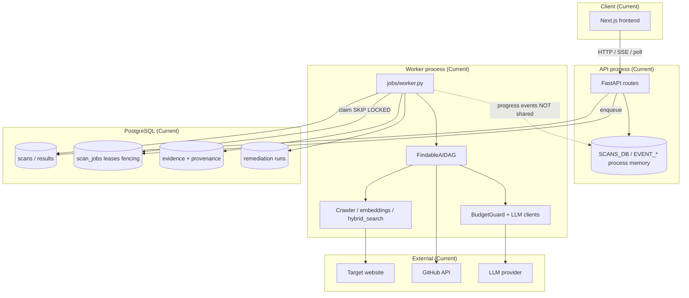
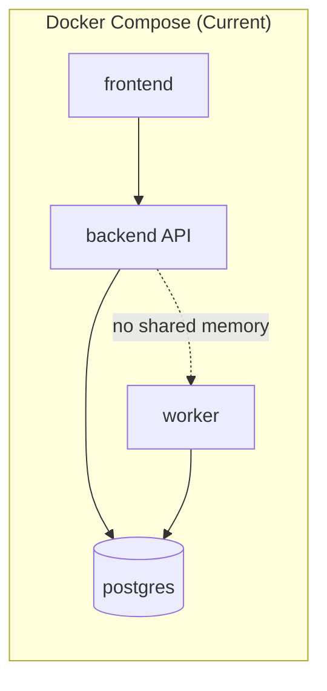

# 03 — Current Architecture

**Diagram label convention:** sections marked **Current** describe the checked-out system. Nothing in this file is proposed infrastructure.

---

## 1. Product purpose and boundaries

**FindableAI** scores and remediates machine discoverability of a customer website:

- **In scope today:** URL scan, crawl/index, LLM evaluation, scoring, patch suggestions, optional GitHub PR, narrow post-PR verification, API + web UI.  
- **Out of scope today:** Multi-region active-active, Redis-backed progress, Celery/RQ brokers, full post-merge production re-crawl as “verification.”

---

## 2. Technology stack (Verified)

| Concern | Technology |
| :--- | :--- |
| API | FastAPI (`backend/app`) |
| Worker | Async Python worker (`jobs/worker.py`) |
| DB | PostgreSQL + Alembic (`0001`–`0005`) |
| ORM | SQLAlchemy async models |
| LLM | Instructor-structured clients + `BudgetGuard` (`core/llm.py`) |
| Crawl/search | Custom crawler + hybrid dense/lexical + RRF |
| Frontend | Next.js (`frontend/`) |
| Deploy local | Docker Compose (`db`, `backend`, `worker`, `frontend`) |
| Auth | Configurable / optionally relaxed for demos (**verify settings**) |

---

## 3. Component architecture (Current)

**Note:** Dashed edge highlights F-01: worker progress does not update API process memory.

---

## 4. Module boundaries (Current)

| Package | Responsibility | Depends on |
| :--- | :--- | :--- |
| `api/` | HTTP contracts, auth gates, enqueue, SSE | models, jobs.queue, orchestration |
| `jobs/` | Claim, lease renew, retry, fencing, worker loop | models, orchestration |
| `orchestration/` | DAG, remediation lifecycle, scoring glue | crawler, core.llm, github, models |
| `crawler/` | Fetch, chunk, embed, search/RRF | core settings, DB |
| `engines/` | Scoring / evaluation helpers | orchestration, models |
| `github/` | PR create/reconcile | settings, remediation |
| `core/` | Config, LLM, security helpers | env |
| `models/` | ORM | SQLAlchemy |

---

## 5. Sync vs async (Current)

| Path | Mode |
| :--- | :--- |
| `POST /scans` validate + persist + enqueue | Synchronous HTTP request |
| Pipeline crawl→LLM→score | Asynchronous worker job |
| SSE progress | Async stream from **API process memory** |
| Poll scan status | Synchronous HTTP against DB |
| GitHub PR | Async within remediation path |
| Alembic | Offline/deploy-time |

---

## 6. Data ownership (Current)

- **Authoritative:** PostgreSQL for scans, jobs, evidence, remediations.  
- **Non-authoritative / ephemeral:** `EVENT_*`, in-memory scan mirrors.  
- **External truth:** GitHub for PR existence; website for crawl content at fetch time.

---

## 7. Security boundaries (Current)

- Tenant/scan isolation via DB ownership fields and API auth (when enabled).  
- Remediation fail-closed: patch validation before mutation.  
- Secrets via environment variables (never commit).  
- Evidence uniqueness constraints (migration `0003_evidence_provenance`).  
- **Unverified:** Hardening of public demo deployments.

---

## 8. Deployment topology (Current)

- `SCAN_JOB_INLINE_FALLBACK=false` expected for production-shaped runs.  
- Redis: if present in compose, **not** required by application scan path (**Verified** non-use in app).

---

## 9. External failure boundaries (Current)

| Dependency | Failure mode | Observed handling (code-level) |
| :--- | :--- | :--- |
| Target site | Timeout / 4xx / bot block | Crawl errors surface into job failure/retry |
| LLM provider | 429 / timeout / schema fail | Retries / BudgetGuard / structured validation |
| GitHub | Timeout / conflict | Remediation reconcile / timeout paths |
| Postgres | Unavailable | Enqueue/claim fail; inline fallback only if enabled |

Exact production SLOs: **Unverified**.

---

## 10. What is *not* in the current architecture

Do **not** draw these as current components:

- Durable progress event log table (Proposed)  
- Checkpoint manager / cache manager services (Proposed)  
- Redis as scan cache (not used)  
- Celery / external broker (not used)  
- Full re-scan verification engine (not what post-PR verify does)

See [04-PROPOSED-ARCHITECTURE.md](./04-PROPOSED-ARCHITECTURE.md).