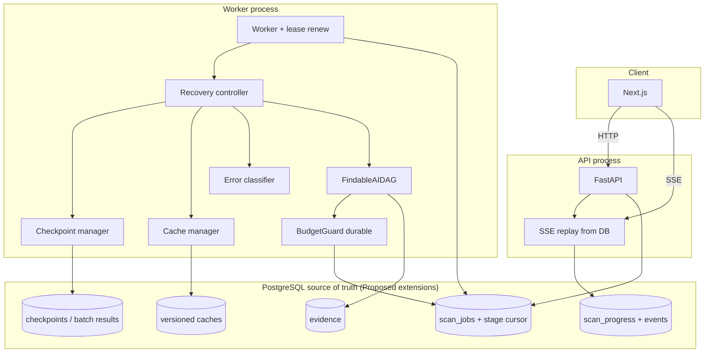
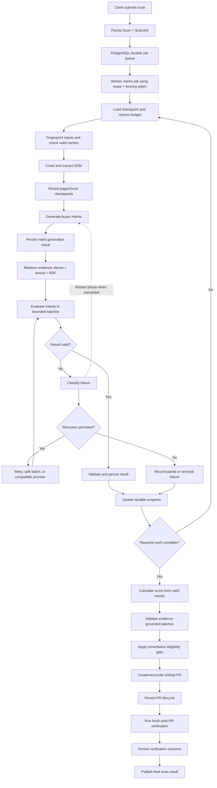

# 04 — Proposed Reliability Architecture

**All content in this file is Proposed** unless explicitly restating a current limitation.  
**Design rule:** Reuse PostgreSQL `scan_jobs`, fencing, BudgetGuard, evidence, and remediation. Do **not** introduce Redis, Celery, or a new broker unless Stage 2 measurements demand it.

---

## 1. Goals and non-goals

### Goals

- Survive worker crash without silent progress loss or unbounded LLM re-spend.  
- Resume from durable stage/batch checkpoints when safe.  
- Enforce call **and** monetary budgets atomically.  
- Deliver accurate progress across API≠worker via durable state + SSE replay.  
- Keep evidence integrity and remediation fail-closed guarantees.

### Non-goals

- Rewrite the DAG from scratch.  
- Multi-cloud HA.  
- Require Redis for the initial implementation.  
- Replace GitHub remediation.  
- Claim full-site re-scan verification in Stage 1.

---

## 2. Motivating limitations (Current → Proposed)

| Current limitation | Proposed response |
| :--- | :--- |
| Process-local events | Durable progress snapshot + ordered events |
| Full-pipeline retries | Stage/batch checkpoints + resume rules |
| Unused `update_llm_checkpoint` | Wire into DAG after each provider batch |
| USD budget observational | Hard reserve against `LLM_BUDGET_CAP_USD` |
| No versioned caches | Fingerprinted caches (Stage 2) |
| Heuristic verify | Keep; label accurately; optional later re-scan |

---

## 3. Target component architecture (Proposed)

**Label:** Target State / Proposed — not present as separate modules today.

---

## 3.1 Durable Scan Execution Engine workflow (Proposed)

End-to-end target control flow for the proposed engine. This is **not** current production behavior. Post-PR verification remains a fresh heuristic check unless a later stage expands it; see [01-CURRENT-STATE-AUDIT.md](./01-CURRENT-STATE-AUDIT.md) (F-07).

**Label:** Proposed / Target State.  
**Also in:** [06-END-TO-END-WORKFLOWS.md](./06-END-TO-END-WORKFLOWS.md) §4.

---

## 4. Proposed component boundaries

| Component | Responsibility | Reuses |
| :--- | :--- | :--- |
| Checkpoint manager | Persist stage/batch success; decide resume point | `scan_jobs`, evidence rows |
| Cache manager | Fingerprint lookup/invalidation | New tables or JSON blobs (**Proposed**) |
| Error classifier | Map exceptions → retry / fallback / fail | Provider errors, crawl errors |
| Recovery controller | On claim: restore budget, skip completed stages | Worker + queue |
| Budget accounting | Atomic call+USD reserve/commit/release | `BudgetGuard`, job columns |
| Progress store | Snapshot + ordered events | New durable fields/tables (**Proposed**) |
| SSE layer | Snapshot + replay by `Last-Event-ID` | API routes |

---

## 5. Source-of-truth decisions (Proposed)

| Concern | Truth |
| :--- | :--- |
| Job state / lease / fence | `scan_jobs` (existing) |
| Stage cursor / checkpoints | Postgres (extend job or child table) |
| Progress for UI | Postgres events + snapshot |
| Evidence | Existing evidence tables |
| Cache entries | Postgres (default); Redis only if measured need |
| PR identity | GitHub + remediation rows |

---

## 6. Alternatives considered

| Alternative | Decision |
| :--- | :--- |
| Redis + Celery rewrite | **Rejected** for Stage 1 — high cost, no evidence of necessity |
| Keep process-memory SSE | **Rejected** — breaks Compose topology |
| Always full re-scan on verify | **Deferred** — expensive; label heuristics first |
| Filesystem-only checkpoints | **Rejected** — not multi-worker safe |

Details: [10-DECISIONS-AND-OPEN-QUESTIONS.md](./10-DECISIONS-AND-OPEN-QUESTIONS.md).

---

## 7. Security and evidence integrity (Proposed constraints)

- Cache hits must carry provenance versions compatible with evidence rules.  
- Resume must not invent evidence without persistence.  
- Remediation remains fail-closed; checkpoints do not bypass patch validation.  
- Progress events must not include secrets, tokens, or raw provider keys.  
- Log redaction unchanged / strengthened.

---

## 8. Observability (Proposed)

- Correlation ID already partially present — propagate on all stage transitions.  
- Metrics: stage latency, resume count, cache hit rate, budget remaining, lease renewals, SSE reconnects.  
- Structured logs with `scan_id`, `job_id`, `fence`, `stage`.

---

## 9. Operational failure modes (Proposed handling)

| Mode | Handling |
| :--- | :--- |
| Worker crash mid-stage | Lease expiry → reclaim → resume from last durable checkpoint |
| Provider 429 | Classifier → backoff retry within bounds → optional model fallback |
| Budget exhausted | Fail closed with clear terminal status |
| Stale fence | Ignore writes from old worker |
| SSE disconnect | Client reconnects with last event id; API replays from DB |

---

## 10. Relation to stages

See [07-IMPLEMENTATION-PLAN.md](./07-IMPLEMENTATION-PLAN.md) for sequencing. Architecture above is the **end state** after Stages 1–3; Stage 1 alone delivers checkpoints, budget durability, and minimal durable progress fields.