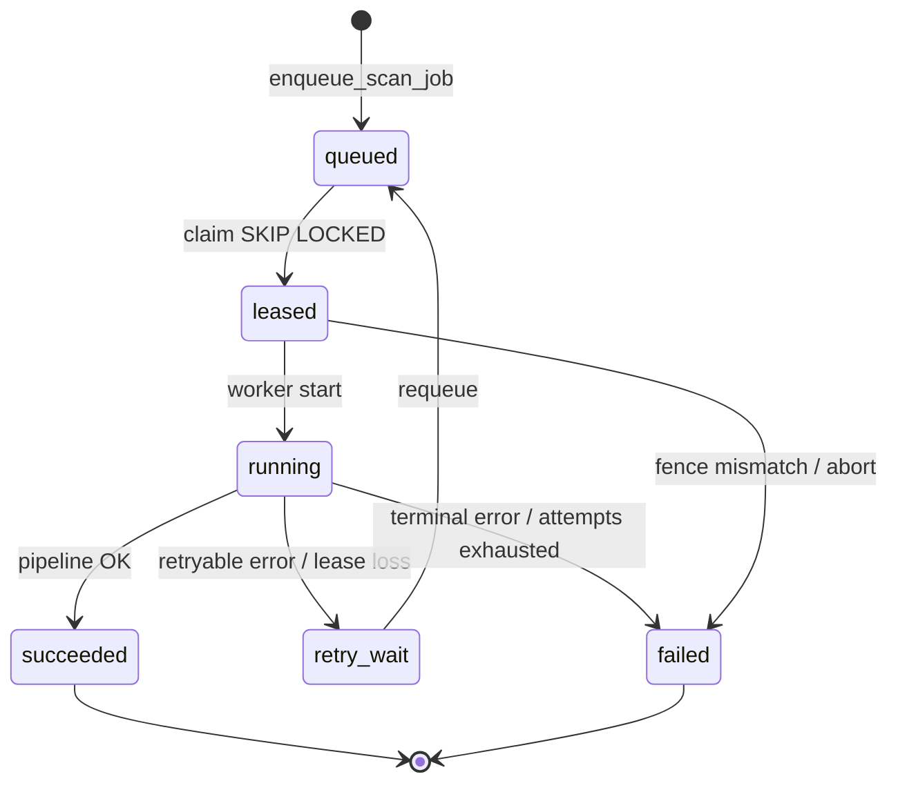
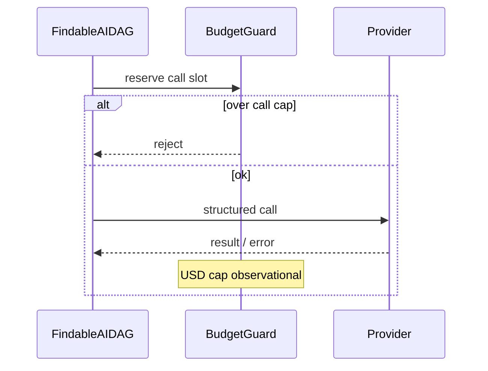
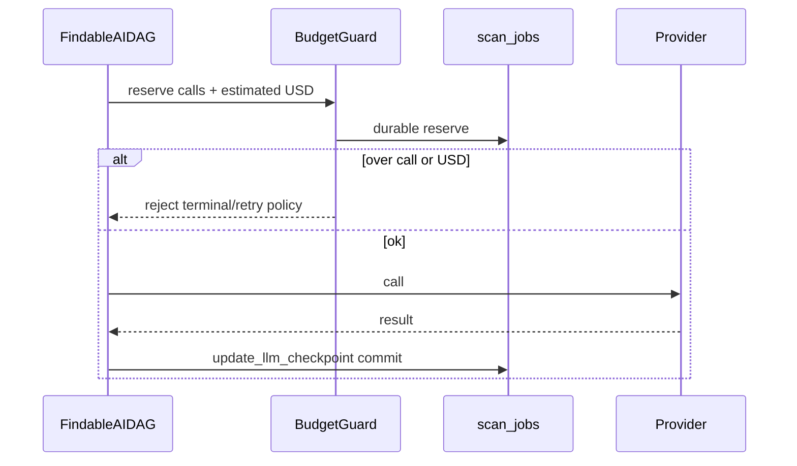
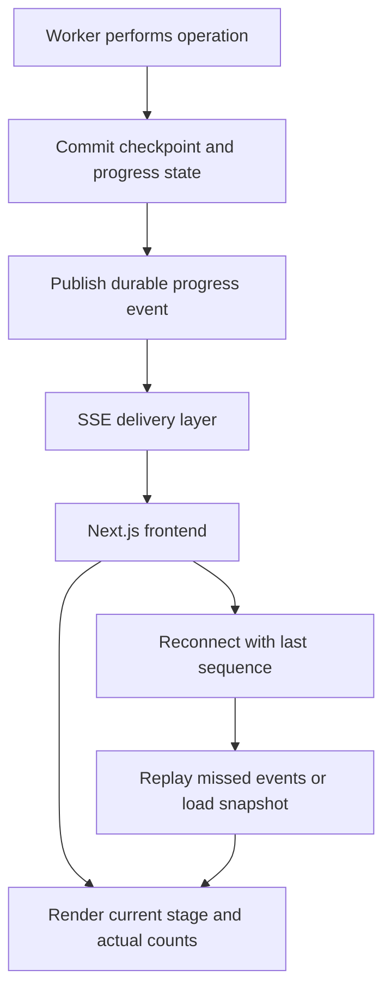
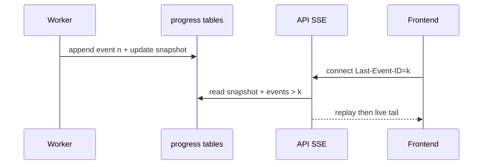

# 05 — System Design

Combines **Current** (verified) design notes and **Proposed** extensions. Proposed schema is labeled; do not treat it as migrated.

---

## 1. API contracts (Current — representative)

Exact OpenAPI is in the running app; names below are code-backed.

| Endpoint area | Role |
| :--- | :--- |
| `POST /api/v1/scans` | Validate URL, create scan, enqueue job |
| `GET /api/v1/scans/{id}` | Scan status / result |
| Progress / SSE routes | Stream process-local events (**Current** limitation F-01) |
| Remediation routes | Trigger/status GitHub PR flows |
| Health / readiness | Process + DB checks (as implemented) |

**Proposed:** SSE routes read durable events; request may honor `Last-Event-ID`.

---

## 2. Data models and relationships (Current)

Core entities (names approximate to models package):

- `Scan` → owns results, scores, integrity payload  
- `ScanJob` → queue state, lease, fence, attempts, optional LLM checkpoint columns  
- Evidence rows → unique provenance  
- Remediation run → PR metadata, verification outcome  

Migrations of note: `0003_evidence_provenance`, `0005` (durable jobs — confirm exact revision name in `alembic/versions/`).

---

## 3. Job lifecycle and state diagram (Current)

**Label:** Current (logical). Exact enum names live in `jobs/queue.py` / models — use code as authority if labels differ slightly.

### Invalid transitions (Current intent)

- `succeeded` → `running` (no reopen without new job)  
- Writes from worker with stale fencing token  
- Claim of job already leased by live fence  

---

## 4. Idempotency and concurrency (Current)

| Mechanism | Behavior |
| :--- | :--- |
| `SKIP LOCKED` | Concurrent workers claim distinct jobs |
| Lease TTL + renew | Prevents zombie ownership while healthy |
| Fencing token | Stale workers cannot complete after reclaim |
| Scan/request idempotency | URL/client keys as implemented in create_scan |
| Remediation idempotency | Reconcile existing PR rather than duplicate |

**Unverified at runtime:** multi-worker stress under load.

---

## 5. Worker lease, fencing, recovery, shutdown (Current + Proposed)

### Current

- Claim sets lease expiry + fence.  
- Renew during long runs.  
- On shutdown, lease may expire for reclaim (**Inferred** exact signal handling — confirm in `worker.py`).  

### Proposed

- Recovery controller on claim: load stage cursor, restore budget checkpoint, decide resume.  
- Mid-stage crash: incomplete stage re-runs; completed stages skip.  
- Batch partial results retained when safely idempotent.

---

## 6. Provider-call and budget lifecycle

### Current

**Gap:** `update_llm_checkpoint` unused mid-pipeline.

### Proposed

**Label:** Proposed.

---

## 7. Checkpoints (Proposed)

| Checkpoint | Contents | Resume rule |
| :--- | :--- | :--- |
| Crawl complete | Content fingerprint, page set | Skip crawl if fingerprint valid |
| Embed complete | Chunk ids / embedding version | Skip embed if versions match |
| Intent batch N | Intent outputs | Skip completed batch indices |
| Eval batch N | Structured results | Skip if schema/model/prompt versions match |
| Score/patches | Artifact ids | Skip if inputs unchanged |

**Safe resume:** Never skip if versions diverge or evidence missing. Prefer recompute over silent skip.

---

## 8. Caching (Proposed — Stage 2)

| Cache | Key inputs | Invalidate when |
| :--- | :--- | :--- |
| Content | URL + fetch headers/etag/hash + crawler version | Content hash changes |
| Retrieval | Query + index version + RRF params | Index rebuild / param change |
| Evaluation | Prompt + schema + model + evidence ids/hash | Any component change |

Default store: PostgreSQL. Redis optional later.

---

## 9. Progress events and SSE (Proposed — Stage 3)

Durable publish-after-commit flow (addresses F-01). Full E2E context: [06-END-TO-END-WORKFLOWS.md](./06-END-TO-END-WORKFLOWS.md) §8.

**Label:** Proposed.  
**Current:** Worker updates process-local queues; API SSE cannot see them.

---

## 10. Evidence provenance and remediation safety (Current)

- Evidence uniqueness / provenance enforced in DB.  
- Patch validation before GitHub mutation.  
- `evaluate_verification_outcome`: heuristics only (see F-07).  
**Proposed:** Checkpoints/caches must not weaken these invariants.

---

## 11. Failure handling and consistency (Current + Proposed)

| Scenario | Current | Proposed |
| :--- | :--- | :--- |
| Transient LLM error | Job retry → full pipeline | Retry stage/batch |
| Worker death | Lease expiry → full re-run | Resume + budget restore |
| Budget exceed (calls) | Reject further calls | Same + USD |
| Remediations | Idempotent reconcile | Unchanged |
| Progress lost | Common in split deploy | Durable replay |

---

## 12. Schema extensions (Proposed — not migrated)

Illustrative only; final design during Stage 1 implementation:

- `scan_jobs.stage`, `scan_jobs.stage_payload_json`, stronger `llm_checkpoint_json`  
- `scan_progress_snapshots`  
- `scan_progress_events (scan_id, seq, type, payload, created_at)`  
- `pipeline_cache_entries (key, version, value, expires_at)`  

Prefer extending existing columns before new tables when possible.