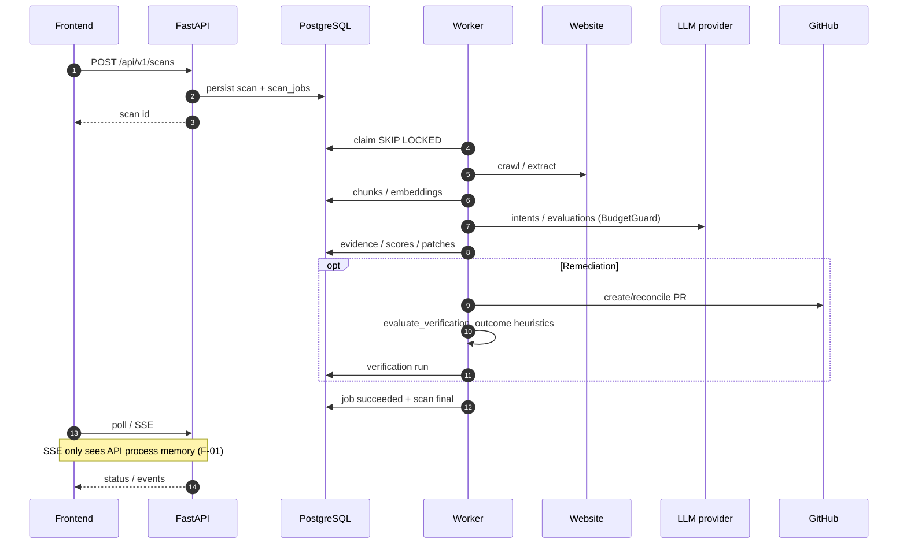
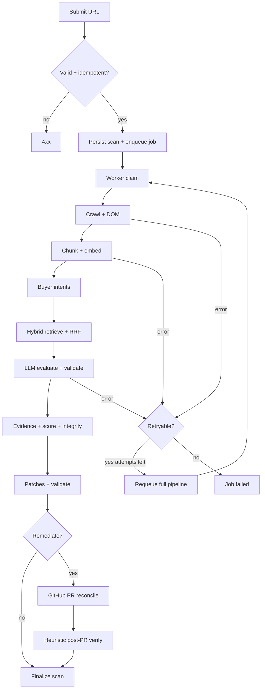
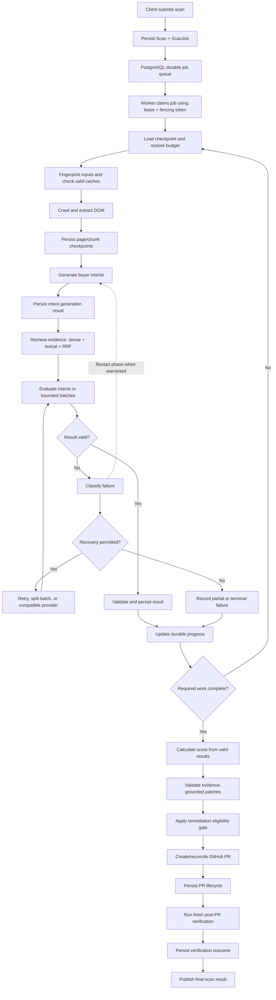
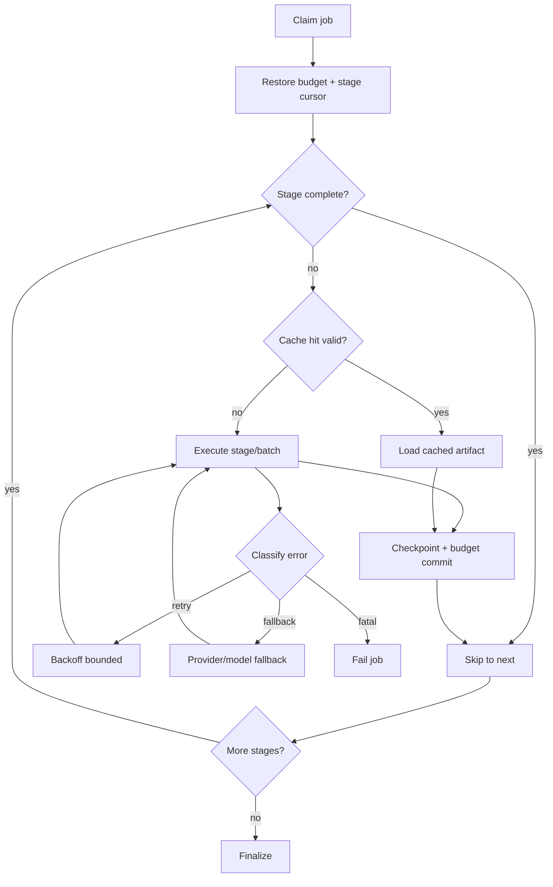
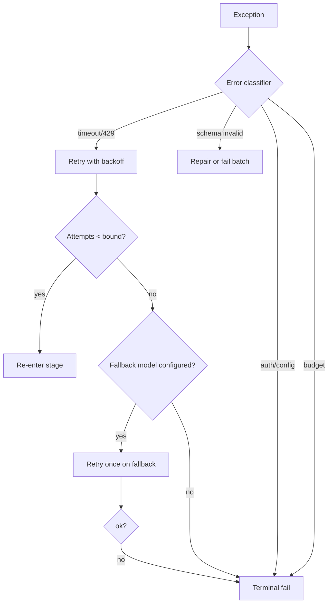
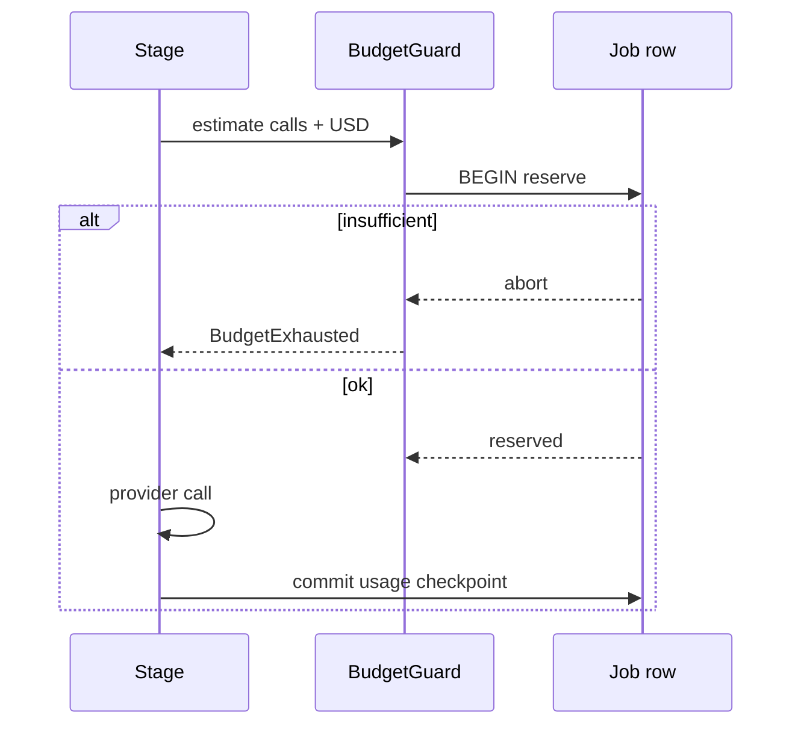
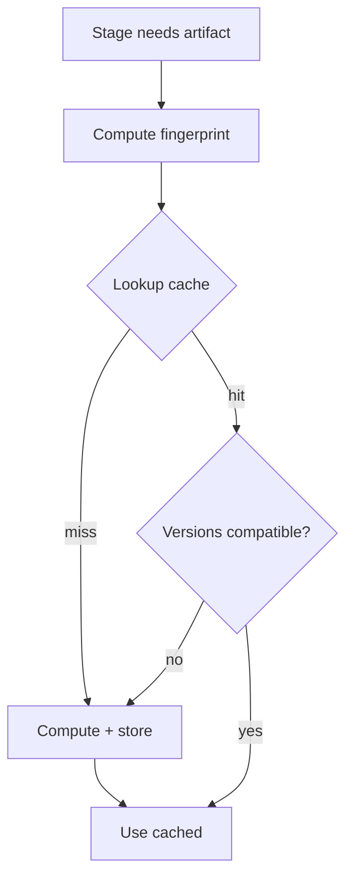
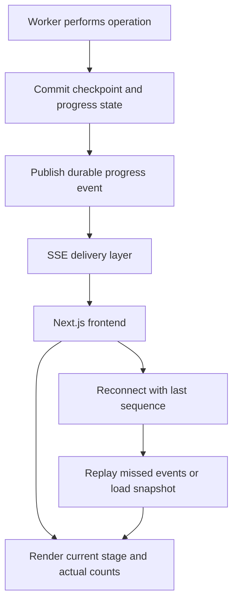
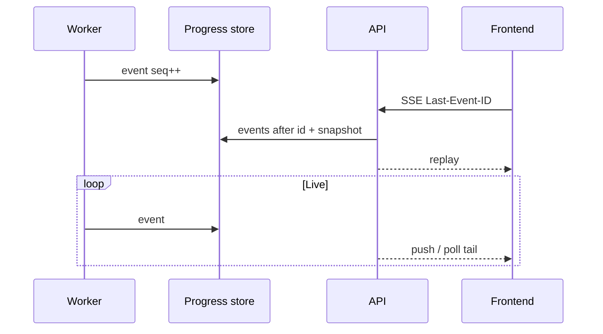
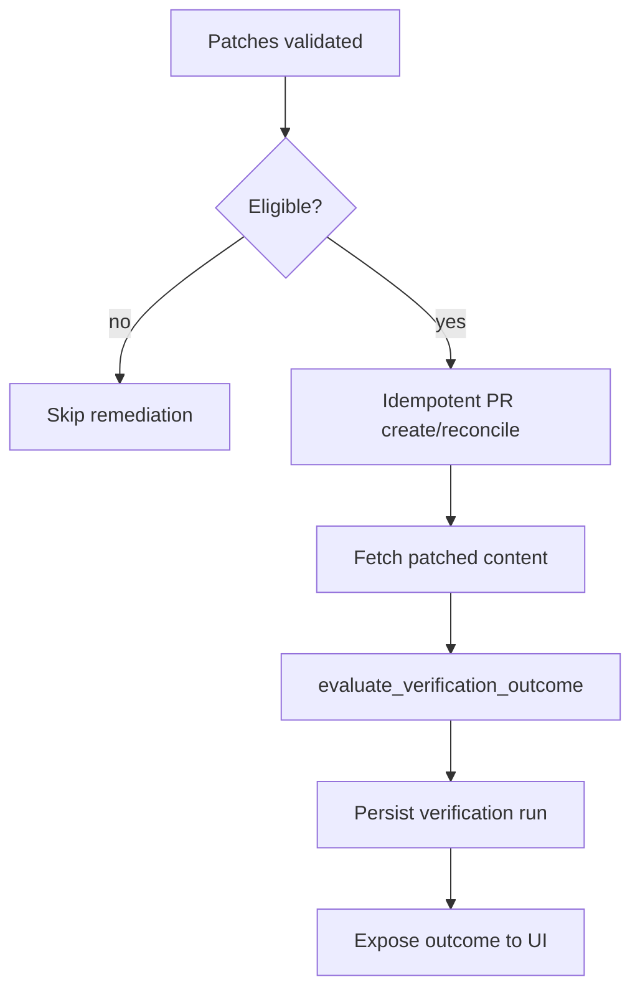

# 06 — End-to-End Workflows

---

## 1. Current scan sequence (Current)

---

## 2. Current workflow flowchart (Current)

---

## 3. Stage I/O summary (Current)

| Stage | Inputs | Outputs / persistence | Failure modes |
| :--- | :--- | :--- | :--- |
| 1 Submit | URL, client key | Scan + job rows | Validation, DB down |
| 2 Claim | Queued jobs | Lease + fence | Contention, DB |
| 3 Crawl | URL | Pages/DOM | Timeout, block |
| 4 Chunk/embed | DOM | Chunks, vectors | Embed provider fail |
| 5 Intents | Site context | Intent set | LLM/schema |
| 6 Retrieve | Intents + index | Ranked evidence | Empty index |
| 7 Evaluate | Evidence + prompts | Structured findings | 429, schema |
| 8 Evidence/score | Findings | Evidence rows, scores | Integrity fail |
| 9 Patches | Findings | Patch artifacts | Validation fail |
| 10 GitHub | Valid patches | PR id | API timeout |
| 11 Verify | PR content + keywords | Outcome enum | Inconclusive |
| 12 Deliver | Scan id | UI via poll/SSE | SSE empty if split |

---

## 4. Proposed Durable Scan Execution Engine (Proposed)

Full target workflow (ingestion → resume/cache → evaluate with recovery → remediate → publish). **Not current production behavior.** Same diagram lives in [04-PROPOSED-ARCHITECTURE.md](./04-PROPOSED-ARCHITECTURE.md) §3.1.

**Label:** Proposed / Target State.

### 4.1 Stage resume helper (Proposed)

Compact recovery loop used inside the engine above:

**Label:** Proposed.

---

## 5. Retry / provider fallback decision (Proposed)

**Label:** Proposed.

---

## 6. Budget reservation (Proposed)

---

## 7. Cache lookup / invalidation (Proposed — Stage 2)

---

## 8. Progress + SSE replay (Proposed — Stage 3)

Durable progress path that fixes process-local `EVENT_*` gaps (F-01). Checkpoint commit happens **before** the progress event is published so reconnect/replay cannot show stages that were never persisted.

**Label:** Proposed / Target State.

Sequence view of the same design:

---

## 9. Remediation + verification (Current)

**Not a full re-scan.** Keyword / validation heuristics only.

---

## 10. Current vs proposed delivery

| Concern | Current | Proposed |
| :--- | :--- | :--- |
| Job durability | Yes | Yes (extended) |
| Stage resume | No | Yes |
| Progress across processes | Broken / poll-only | Durable + SSE replay |
| Budget mid-run | Incomplete | Checkpointed |
| Cache | None | Versioned (Stage 2) |
| Verification | Heuristic | Heuristic + honest labeling |