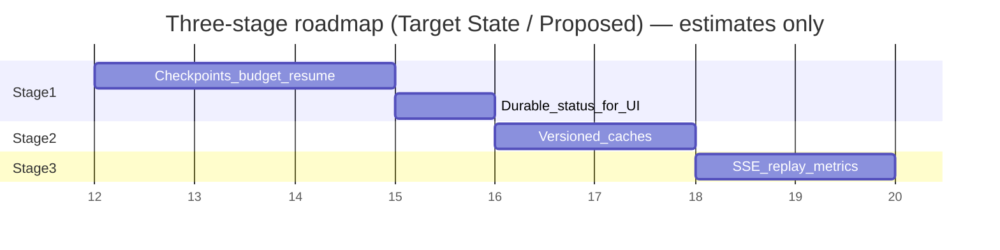

# 07 — Implementation Plan

**Constraint:** ~8-day submission window. Prioritize Stage 1 correctness and demo-visible progress. Stage 2–3 are incremental.  
**All stages are Proposed** until authorized. Do not assume exact diffs before implementation review.

Estimates are **effort guesses**, not commitments.

---

## Stage 1 — Durable execution and recovery

### Objective

Survive crashes/retries without full-pipeline re-spend; restore LLM budget; expose durable status the UI can poll even when SSE is broken.

### Existing behavior

Full job retry; unused `update_llm_checkpoint`; process-local progress; call-cap BudgetGuard; USD observational.

### Proposed behavior

Stage/batch checkpoints; safe resume; durable budget; error classification; bounded retry/fallback; minimal durable progress fields on scan/job.

### Implementation sequence (Proposed)

1. Inventory DAG stages and side effects (`orchestration/dag.py`).  
2. Define stage enum + resume rules document (code comments + this package).  
3. Extend job payload / columns **only if needed** after attempting reuse of existing checkpoint fields.  
4. Wire `update_llm_checkpoint` after each reserved batch; restore on claim.  
5. Add USD reserve to BudgetGuard.  
6. Error classifier module (new small helper under `jobs/` or `orchestration/`).  
7. Recovery controller at worker start.  
8. Persist `stage` / `percent` / `message` on scan or job for UI poll.  
9. Tests: unit + opt-in PG crash recovery.

### Modules / files to inspect or extend

- `backend/app/jobs/queue.py`, `worker.py`  
- `backend/app/orchestration/dag.py`  
- `backend/app/core/llm.py`, `core/config.py`  
- `backend/app/models/*` (ScanJob)  
- Alembic only if reuse insufficient (**Proposed** migration)  
- Frontend poll hooks (status fields only)

### Schema implications

Prefer existing job JSON/columns. New migration only if necessary.

### Failure scenarios

Partial checkpoint write; fence mismatch; resume with missing evidence; budget restore race.

### Tests

- Resume after mock crash at each stage boundary  
- Fence stale write ignored  
- Concurrent budget reservation  
- PG opt-in suite expanded  

### Acceptance criteria

- [ ] Kill worker mid-run → reclaim resumes without repeating completed durable stages  
- [ ] LLM call counts survive restart within tolerance  
- [ ] USD cap blocks further spend when exceeded  
- [ ] UI poll shows advancing stage with API≠worker  
- [ ] No remediation safety regressions  

### Risks / dependencies

Incorrect skip logic; migration risk; timeboxing.

### Effort estimate

**~3–4 days** (estimate).

### Out of scope

Redis; full SSE replay; eval caches; full re-scan verify.

---

## Stage 2 — Versioned caching and provider efficiency

### Objective

Cut repeat cost for identical content/retrieval/eval fingerprints; selective retries; measure provider cost.

### Existing behavior

No versioned caches; full recompute.

### Proposed behavior

Content / retrieval / evaluation caches with strict version keys; selective batch retry; optional adaptive batching; **no Redis required** initially.

### Implementation sequence

1. Fingerprint helpers (content hash, prompt/schema/model/retrieval versions).  
2. Cache store table or keyed JSON.  
3. Integrate lookups at crawl, retrieve, evaluate.  
4. Metrics for hit/miss.  
5. Benchmark before any local-model fallback.

### Modules

- `crawler/*`, `orchestration/dag.py`, new `cache` helper module  
- Models + migration if needed  

### Acceptance criteria

- [ ] Cache miss on any version mismatch  
- [ ] Hit reduces provider calls in deterministic test  
- [ ] Evidence provenance preserved  
- [ ] Documented invalidation rules  

### Effort estimate

**~2 days** (estimate) after Stage 1.

### Out of scope

Redis unless measurements justify; local model eval without benchmarks.

---

## Stage 3 — Durable progress and observability

### Objective

SSE reconnection with replay; accurate frontend progress; ops metrics.

### Existing behavior

Process-local events; correlation IDs partially present.

### Proposed behavior

Ordered events + snapshot; SSE `Last-Event-ID`; structured metrics; e2e validation on Compose.

### Implementation sequence

1. Progress tables / append API from worker.  
2. API SSE reads DB.  
3. Frontend reconnect.  
4. Metrics export hooks.  
5. Retention policy for events.  

### Acceptance criteria

- [ ] Disconnect/reconnect replays missed events  
- [ ] API≠worker live progress works  
- [ ] No secrets in event payloads  
- [ ] Rollback plan documented  

### Effort estimate

**~2 days** (estimate).

### Out of scope

Changing remediation semantics; rewriting frontend UX beyond progress accuracy.

---

## Cross-stage priorities for submission

| Priority | Item |
| :--- | :--- |
| Must | Stage 1 resume + budget + durable status poll |
| Should | Stage 3 minimal SSE or honest “polling” UX |
| Nice | Stage 2 caches |
| Later | Doc reconciliation PR for old engineering docs; full re-scan verify |

---

## Rollback strategy (Proposed)

- Feature flags for resume/cache/SSE-from-DB.  
- Keep ability to force full re-run.  
- Migrations expandable/nullable; avoid destructive drops.  
- Worker/API independent rollback via image pin.

---

## Authorization gate

**Do not start coding Stage 1 until this documentation package is reviewed and implementation is explicitly authorized.**