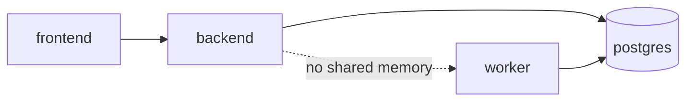

# 09 — Deployment and Operations

Distinguishes **Current** configuration from **Recommended / Proposed** improvements. Env vars by **name only** — never values.

---

## 1. Topology (Current)

| Service | Role |
| :--- | :--- |
| `frontend` | Next.js UI |
| `backend` | FastAPI |
| `worker` | Job consumer |
| `postgres` | Source of truth |

Redis, if defined in compose/env, is **not** required by application scan code (**Verified** non-use).

---

## 2. Environment variables (names only)

Confirm presence/defaults in `backend/app/core/config.py`, `.env.example`, and [ENVIRONMENT.md](../ENVIRONMENT.md).

| Variable (name) | Area | Notes |
| :--- | :--- | :--- |
| `DATABASE_URL` | DB | Required for durable jobs |
| `SCAN_JOB_INLINE_FALLBACK` | Jobs | Default **false** for production-shaped deploys |
| `LLM_*` / provider keys | LLM | Secrets — never log |
| `LLM_BUDGET_CAP_USD` | Budget | Observational today; Proposed hard enforce |
| Lease / worker tuning vars | Jobs | As defined in config (TTL, concurrency) |
| GitHub token vars | Remediation | Secrets |
| Auth-related vars | Security | May allow optional auth in demos |

**Recommended (Proposed):** Explicit `PROGRESS_EVENT_RETENTION_HOURS`, feature flags for resume/cache/SSE-from-DB when implemented.

---

## 3. Migration ordering (Current)

1. Ensure Postgres up.  
2. Run Alembic upgrade to head (`0001`…`0005` as present).  
3. Start API.  
4. Start worker.  
5. Start frontend.

Never run migrations from undocumented ad-hoc SQL in production.

---

## 4. Worker configuration and health (Current + Recommended)

**Current:** Worker loop claims jobs, renews leases, respects fencing. Health/readiness endpoints exist at API (and possibly worker — **Needs validation** of exact paths).

**Recommended:**

- Liveness: process up  
- Readiness: DB connect + can SELECT job table  
- Alert if `leased`/`running` beyond N× lease TTL  
- Cap worker concurrency to provider budget  

---

## 5. `SCAN_JOB_INLINE_FALLBACK` (Current)

| Value | Meaning |
| :--- | :--- |
| `false` (default intent) | API enqueues only; worker executes |
| `true` | Emergency/dev: API may run work inline |

**Production recommendation:** keep `false`. Inline mode reintroduces single-process assumptions and muddies leases.

---

## 6. Provider timeouts, concurrency, retries, budgets (Current)

- Timeouts/retries configured in LLM client layer.  
- `BudgetGuard` enforces call reservations.  
- USD cap not hard stop today.  

**Proposed:** enforce USD; surface remaining budget in ops metrics.

---

## 7. Monitoring and alerting (Current sparse / Proposed)

| Signal | Current | Proposed |
| :--- | :--- | :--- |
| Job age in leased/running | Logs/manual | Alert |
| Retry count | DB columns | Dashboard |
| Budget remaining | Partial | Metric |
| SSE clients | Unknown | Optional |
| Provider 429 rate | Logs | Metric |

---

## 8. Stuck-job recovery (Current + Proposed)

**Current:** Lease expiry allows reclaim; attempts eventually fail job.  
**Proposed:** Resume from checkpoint; ops runbook to force `full_rerun` flag if checkpoint corrupt.

Manual steps (ops):

1. Identify `scan_id` / `job_id`.  
2. Confirm fence/lease timestamps.  
3. Prefer automatic reclaim; avoid hand-editing rows unless documented.  
4. If forcing fail, record reason for audit.

---

## 9. Retention (Proposed)

| Data | Suggestion |
| :--- | :--- |
| Progress events | Rolling window (e.g. 7 days) |
| Cache entries | TTL + version eviction |
| Job rows | Retain with scans per product policy |

---

## 10. Secrets and log redaction (Current + Recommended)

- Secrets only in env / secret manager.  
- Never log authorization headers, tokens, raw provider payloads with keys.  
- Progress events must be redacted by construction.

---

## 11. Rollback and known limitations (Current)

| Limitation | Impact |
| :--- | :--- |
| Process-local SSE | Live progress unreliable in Compose |
| Opt-in PG tests | Concurrency unverified in ordinary CI |
| Heuristic verify | Do not market as full re-scan |
| Unused Redis | Do not depend on it |

**Rollback:** pin previous images; keep DB migrations backward-compatible when adding nullable columns.

---

## 12. Release checklist (Proposed for Stage 1+)

- [ ] Alembic head applied on disposable then prod-like  
- [ ] `FINDABLE_PG_INTEGRATION=1` suite green  
- [ ] `SCAN_JOB_INLINE_FALLBACK=false`  
- [ ] Worker + API both healthy  
- [ ] Demo path uses poll or DB-backed SSE  
- [ ] No secrets in logs from smoke scan (mocked LLM preferred)  
- [ ] Remediation disabled or sandbox-only for public demos  

---

## 13. Related existing docs (read-only)

- [DEPLOYMENT.md](../DEPLOYMENT.md)  
- [ENVIRONMENT.md](../ENVIRONMENT.md)  
- [DURABLE_JOBS.md](../DURABLE_JOBS.md)